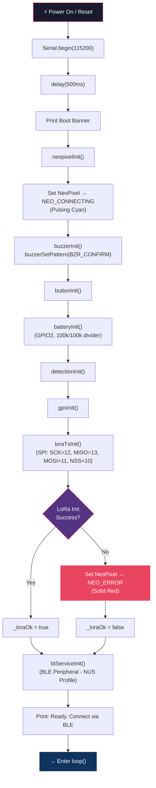
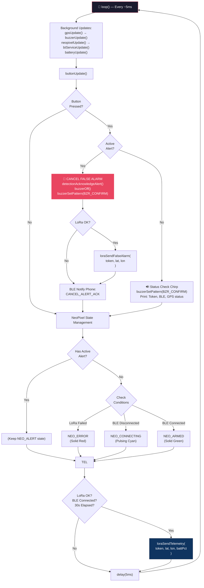
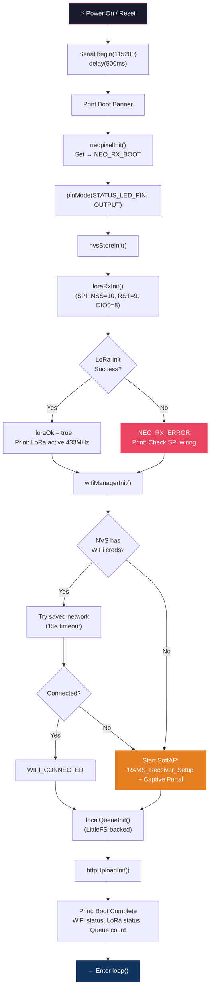
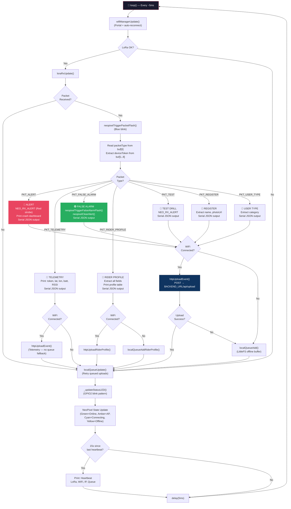
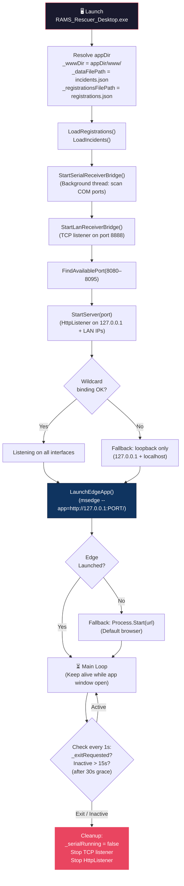
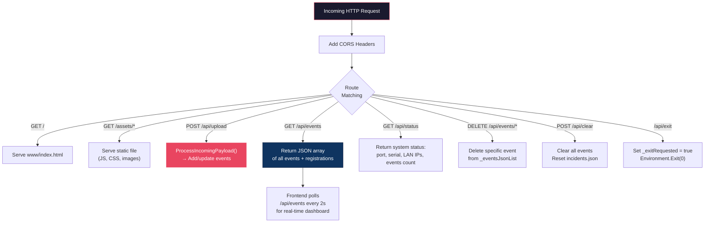
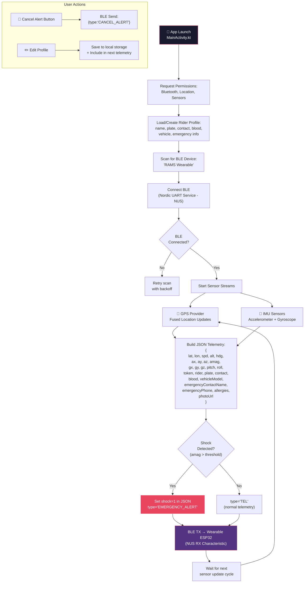
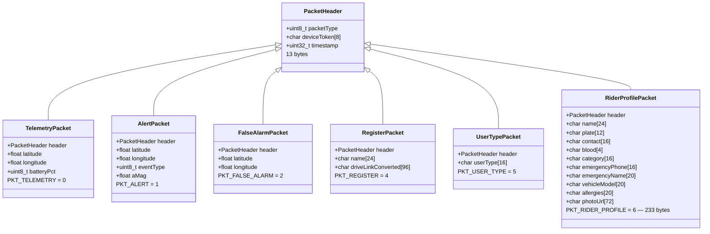

# RAMS — Code Flow Flowchart

> Internal code execution flow for each component of the Road Accident Monitoring System.
> Reference: `Working Code - Do Not Touch/Road-Accident-Monitoring-System-main/`

---

## 1. Wearable Firmware Code Flow (`wearable_withApp/`)

> ESP32-S3 SuperMini + Ra-02 LoRa SX1278 (433MHz) + BLE + Buzzer + NeoPixel

### 1.1 Boot / `setup()` Sequence



### 1.2 Main `loop()` Cycle



### 1.3 BLE Incoming Message Processing (`bt_service.cpp`)

```mermaid
flowchart TD
    RX["📲 BLE RX Characteristic\nonWrite() Callback"] --> BUF["Append chunk to _rxBuffer"]
    BUF --> STRIP["Strip leading garbage\nbefore first '{'"]
    STRIP --> NL{Contains\n'\\n'?}

    NL -- Yes --> EXTRACT["Extract complete message\n(up to newline)"]
    EXTRACT --> PARSE["_processIncomingMessage(msg)"]
    PARSE --> NL

    NL -- No --> STANDALONE{Starts with '{'\nEnds with '}' ?}
    STANDALONE -- Yes --> PARSE2["_processIncomingMessage(msg)\nClear buffer"]
    STANDALONE -- No --> OVERFLOW{Buffer\n> 2048?}
    OVERFLOW -- Yes --> CLEAR["Clear buffer\n(safety reset)"]
    OVERFLOW -- No --> DONE["Done — wait for\nnext BLE write"]

    PARSE --> MSG_TYPE{"Message\nType?"}

    MSG_TYPE -- "CANCEL_ALERT /\nDISMISS_FALSE_ALARM" --> ACK["detectionAcknowledgeAlert()\nbuzzerOff() → NEO_ARMED\nloraSendFalseAlarm()\nBLE reply: CANCEL_ALERT_ACK"]

    MSG_TYPE -- "Telemetry / GPS\n(contains 'lat':)" --> JSON["Parse JSON with ArduinoJson"]
    JSON --> SYNC_TOKEN["Sync rider token\nfrom 'token' field"]
    SYNC_TOKEN --> UPDATE_GPS["gpsSetExternalLocation(\n  lat, lon, spd, alt\n)"]
    UPDATE_GPS --> PROFILE_CHK{"Rider name set?\n30s since last?"}
    PROFILE_CHK -- Yes --> SEND_PROFILE["loraSendRiderProfile(\n  token, name, plate, contact,\n  blood, category, emergency...\n)"]
    PROFILE_CHK -- No --> SHOCK_CHK

    SEND_PROFILE --> SHOCK_CHK{"shock == 1 ?\nOR type == EMERGENCY?"}
    SHOCK_CHK -- Yes --> CRASH["🚨 CRASH DETECTED!\ndetectionTriggerAlert()\nNEO_ALERT → BZR_ALERT\nloraSendAlert(token, lat, lon, aMag)"]
    SHOCK_CHK -- No --> DONE2["Continue"]

    MSG_TYPE -- "PING" --> PONG["Reply: PONG"]
    MSG_TYPE -- "Unknown" --> LOG["Log unknown message"]

    style RX fill:#533483,stroke:#e94560,color:#fff
    style CRASH fill:#e94560,stroke:#fff,color:#fff
    style SEND_PROFILE fill:#0f3460,stroke:#16213e,color:#fff
```

---

## 2. Receiver Firmware Code Flow (`receiver_withDesktop/`)

> ESP32-S3 SuperMini + Ra-02 LoRa SX1278 (433MHz RX) + WiFi + NeoPixel

### 2.1 Boot / `setup()` Sequence



### 2.2 Main `loop()` Cycle



---

## 3. Desktop App Code Flow (`desktop_app/Program.cs`)

> C# .NET 4.0 — Standalone WinForms with Embedded HTTP Server + Serial Bridge

### 3.1 Boot / `Main()` Sequence



### 3.2 Data Ingestion — Dual Bridge Architecture

```mermaid
flowchart TD
    subgraph USB["🔌 USB Serial Bridge (Auto-Detect)"]
        S1["SerialMonitorWorker\n(scan COM ports every 2s)"]
        S1 --> S2["For each new port:\nSpawn ReadPortWorker thread"]
        S2 --> S3["SerialPort.Open()\n115200, 8N1, DTR=true"]
        S3 --> S4["ReadLine() loop"]
        S4 --> S5{Starts with '{'\nEnds with '}' ?}
        S5 -- Yes --> S6["ProcessIncomingReceiverPacket()"]
        S5 -- No --> S4
    end

    subgraph LAN["📡 LAN TCP Bridge (Port 8888)"]
        L1["TcpListener on 0.0.0.0:8888"]
        L1 --> L2["AcceptTcpClient()"]
        L2 --> L3["HandleLanClient()\n(ThreadPool)"]
        L3 --> L4["Read HTTP POST body"]
        L4 --> L5["ProcessIncomingPayload()"]
    end

    subgraph HTTP["🌐 HTTP Server API"]
        H1["POST /api/upload"]
        H1 --> H2["Read JSON body\nor form fields"]
        H2 --> H3["ProcessIncomingPayload()"]
    end

    S6 --> PROC["ProcessIncomingPayload()"]
    L5 --> PROC
    H3 --> PROC

    style USB fill:#1a1a2e,stroke:#e94560,color:#fff
    style LAN fill:#0f3460,stroke:#16213e,color:#fff
    style HTTP fill:#533483,stroke:#e94560,color:#fff
```

### 3.3 `ProcessIncomingPayload()` — Event Routing

```mermaid
flowchart TD
    ENTRY["ProcessIncomingPayload(\n  payload, defaultPrefix\n)"] --> EXTRACT["Extract fields:\nevent, token, packetType"]

    EXTRACT --> TYPE{"Packet\nType?"}

    TYPE -- "register /\nrider_profile" --> REG["Extract rider fields:\nname, photo, plate, phone,\nblood, vehicle, emergency,\nallergies"]
    REG --> MERGE["Merge with existing\n_registrations[token]\n(preserve non-empty fields)"]
    MERGE --> SAVE_REG["SaveRegistrations()\n→ registrations.json"]
    SAVE_REG --> ENRICH["Enrich existing events:\nUpdate photoUrl, riderName,\nvehicleModel, etc. for\nmatching deviceToken"]
    ENRICH --> SAVE_INC["SaveIncidents()\n→ incidents.json"]

    TYPE -- "user_type" --> UT["Extract category\nUpdate _registrations[token]\nvehicleModel field"]

    TYPE -- "telemetry" --> TEL_VAL{Valid\ncoordinates?\n(not 0,0)}
    TEL_VAL -- No --> DISCARD["Discard\n(no GPS fix)"]
    TEL_VAL -- Yes --> TEL_UPD["Remove old telemetry\nfor same token\nInsert new at position 0"]
    TEL_UPD --> SAVE_T["SaveIncidents()"]

    TYPE -- "false_alarm" --> FA_MATCH["Pass 1: Match by token\nFind ACTIVE ALERT events"]
    FA_MATCH --> FA_FOUND{Token\nMatch?}
    FA_FOUND -- Yes --> FA_UPD["Update status → 'FALSE ALARM'\nUpdate type → 'false_alarm'"]
    FA_FOUND -- No --> FA_RECENT["Pass 2: Cancel most recent\nACTIVE ALERT (any token)"]
    FA_RECENT --> FA_LAST{Found\nany alert?}
    FA_LAST -- Yes --> FA_UPD
    FA_LAST -- No --> FA_NEW["Insert new false_alarm record\n(if valid coordinates)"]
    FA_UPD --> SAVE_FA["SaveIncidents()"]
    FA_NEW --> SAVE_FA

    TYPE -- "alert / test" --> COORD_CHK{Valid\ncoordinates?}
    COORD_CHK -- No --> FALLBACK["Fallback: Use last-known\nlocation for this token"]
    COORD_CHK -- Yes --> BUILD
    FALLBACK --> BUILD["BuildEventFromJsonOrForm()\nGenerate event ID:\n'RAMS-ALERT-yyyyMMdd-HHmmss-fff'"]
    BUILD --> INSERT["Insert at position 0\nof _eventsJsonList"]
    INSERT --> SAVE_A["SaveIncidents()\n→ incidents.json"]

    style ENTRY fill:#1a1a2e,stroke:#e94560,color:#fff
    style DISCARD fill:#95a5a6,stroke:#fff,color:#fff
    style FA_UPD fill:#27ae60,stroke:#fff,color:#fff
    style BUILD fill:#e94560,stroke:#fff,color:#fff
```

### 3.4 HTTP API Endpoints



---

## 4. Android Companion App Code Flow (`android_app/`)

> Kotlin — BLE Central + GPS + IMU Sensors



---

## 5. Shared LoRa Protocol (`shared/protocol.h`)

### Packet Structure Summary



### LoRa Radio Configuration

| Parameter | Value |
|-----------|-------|
| **Frequency** | 433 MHz (ISM Band) |
| **Spreading Factor** | SF9 |
| **Bandwidth** | 125 kHz |
| **Coding Rate** | CR 4/5 |
| **TX Power** | 17 dBm |
| **Sync Word** | 0x34 |
| **CRC** | Enabled |
| **Max Payload** | ~255 bytes |

---

*Generated from the working codebase at `Working Code - Do Not Touch/Road-Accident-Monitoring-System-main/`*
