# RAMS — Program Flowchart (Algorithmic Logic Flow)

> **Road Accident Monitoring System (RAMS)**  
> **Formal Program Flowchart for Firmware & Software Algorithms**  
> *Reference Codebase: `Working Code - Do Not Touch/Road-Accident-Monitoring-System-main/`*  
> *Target Competition/Defense: PGC Digital Innovation Challenge / Capstone Engineering*

---

## 1. Overview & Program Flowchart Definition

A **Program Flowchart** illustrates the detailed, step-by-step algorithmic execution logic within software and firmware source code. It depicts program entry points, variable initialization, iterative loops, decision branching, error handling, subroutines, and termination conditions.

### Standard ANSI / ISO Program Flowchart Symbols Used:
- `([Terminal: Start / End / Return])` — Program or subroutine entry/exit point.
- `{{Preparation / Initialization}}` — Hardware pin setup, memory allocation, variable declaration.
- `[/Input / Output Operation/]` — Reading sensor registers, UART/BLE data reception, packet transmission.
- `[Process / Action]` — Computations, data structure manipulation, mathematical formulas.
- `{Decision / Conditional Branch}` — If/else evaluation, threshold check, status comparison.
- `[[Predefined Process / Subroutine]]` — Encapsulated function or method call.
- `((On-Page Connector))` — Connecting disparate branches cleanly without line tangling.

---

## 2. Wearable Firmware Program Flowchart (`wearable_withApp/`)

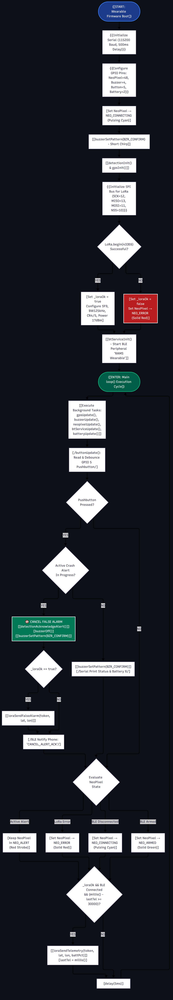

> **High-Resolution Formats:**  
> • [Download Vector SVG](graphics/Program_Flowchart_Wearable.svg) *(infinite resolution zoom for posters/slides)*  
> • [Download 300 DPI PNG](graphics/Program_Flowchart_Wearable.png) *(ready for PowerPoint / Canva / Google Slides)*

<b>Click to View Algorithmic Step-by-Step Sub-Flowcharts & Mermaid Code</b>

### 2.1 Boot & Initialization Routine (`setup()`)

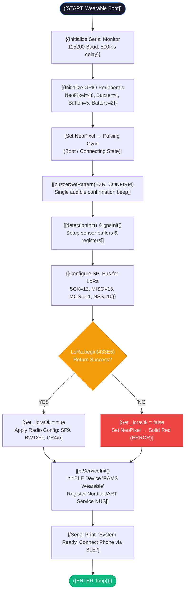

### 2.2 Main Execution Cycle Routine (`loop()`)

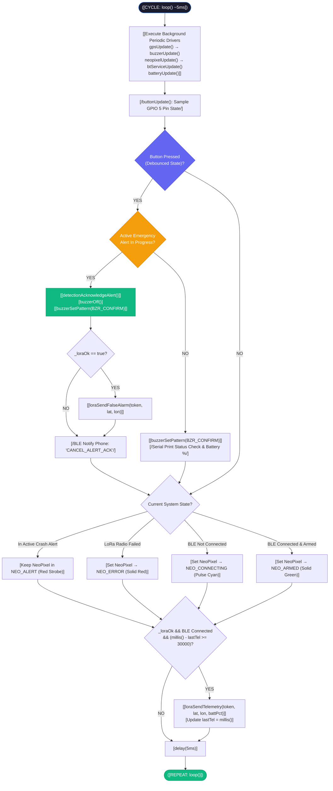

### 2.3 BLE Incoming Packet & Crash Decision Routine (`bt_service.cpp`)

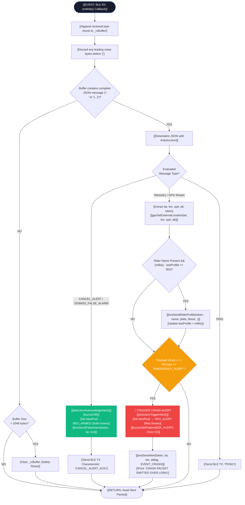

---

## 3. Receiver Firmware Program Flowchart (`receiver_withDesktop/`)

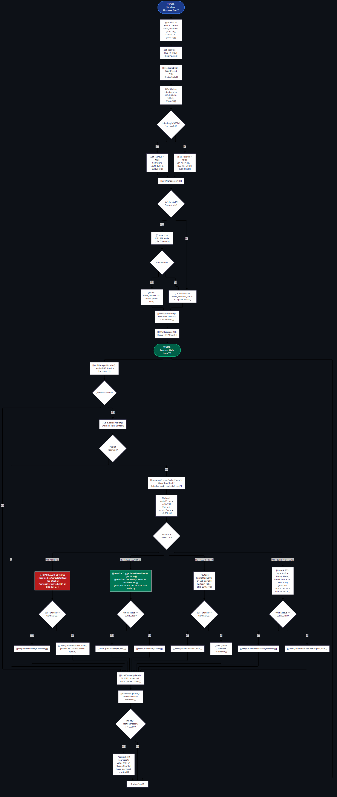

> **High-Resolution Formats:**  
> • [Download Vector SVG](graphics/Program_Flowchart_Receiver.svg)  
> • [Download 300 DPI PNG](graphics/Program_Flowchart_Receiver.png)

<b>Click to View Algorithmic Step-by-Step Logic & Mermaid Code</b>

### 3.1 Packet Ingestion & Routing Routine (`loop()`)

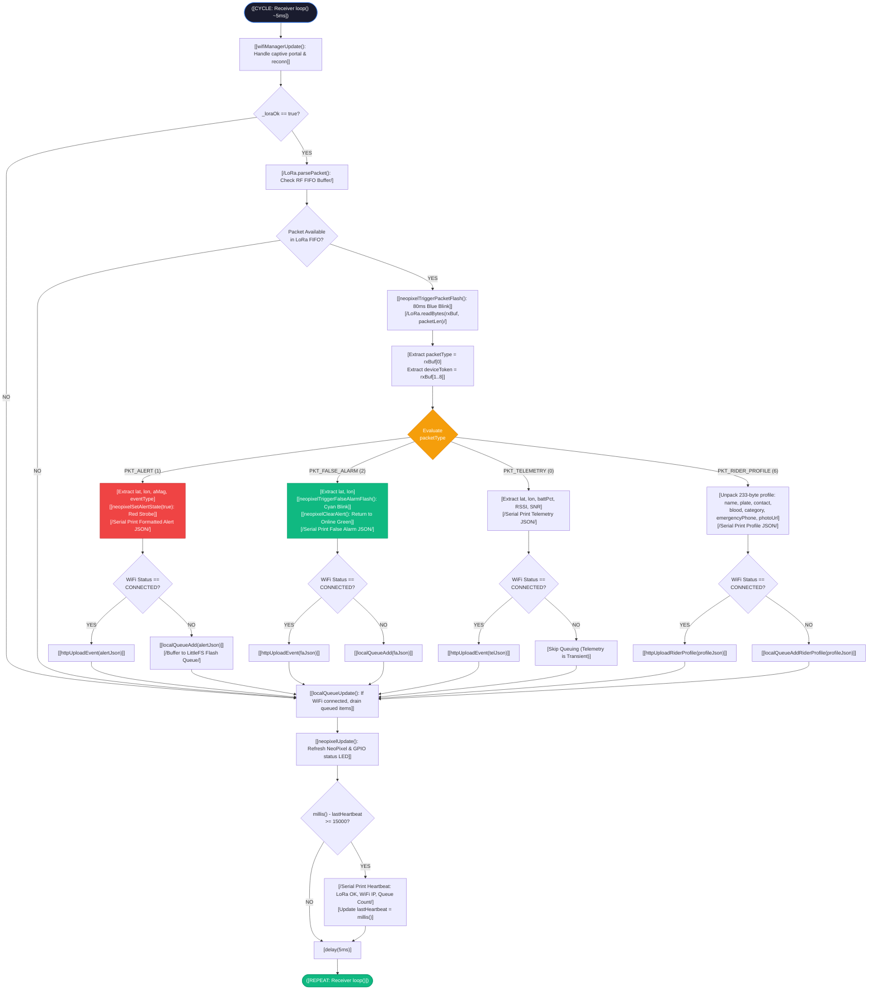

---

## 4. Desktop Rescuer Application Program Flowchart (`desktop_app/Program.cs`)

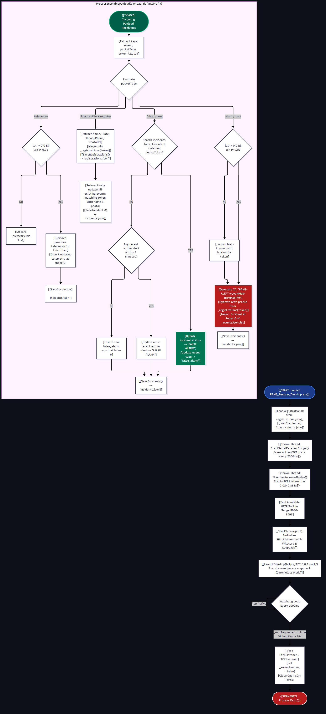

> **High-Resolution Formats:**  
> • [Download Vector SVG](graphics/Program_Flowchart_Desktop.svg)  
> • [Download 300 DPI PNG](graphics/Program_Flowchart_Desktop.png)

<b>Click to View Algorithmic Step-by-Step Logic & Mermaid Code</b>

### 4.1 Master Entry Point & Background Worker Init (`Main()`)

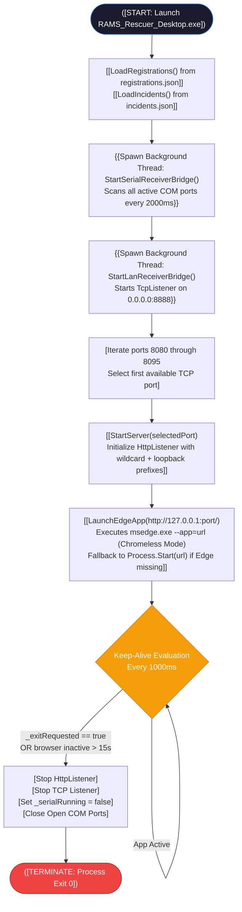

### 4.2 Event Processing Algorithm (`ProcessIncomingPayload()`)

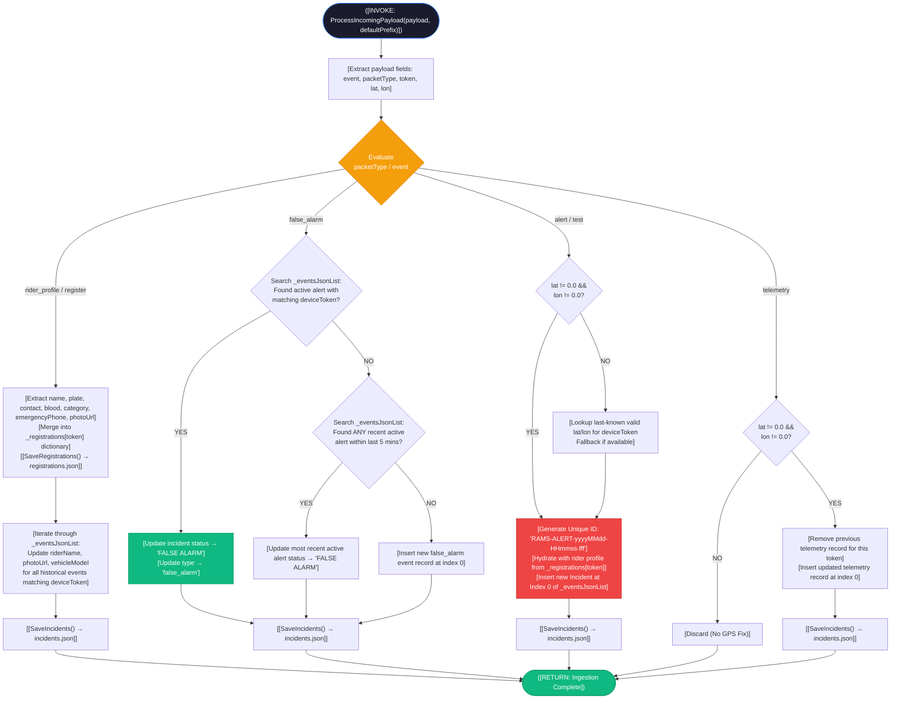

---

## 5. Android Companion Application Program Flowchart (`android_app/`)

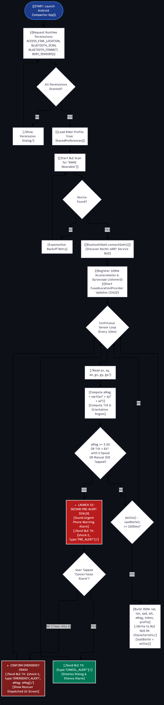

> **High-Resolution Formats:**  
> • [Download Vector SVG](graphics/Program_Flowchart_Android.svg)  
> • [Download 300 DPI PNG](graphics/Program_Flowchart_Android.png)

<b>Click to View Algorithmic Step-by-Step Logic & Mermaid Code</b>

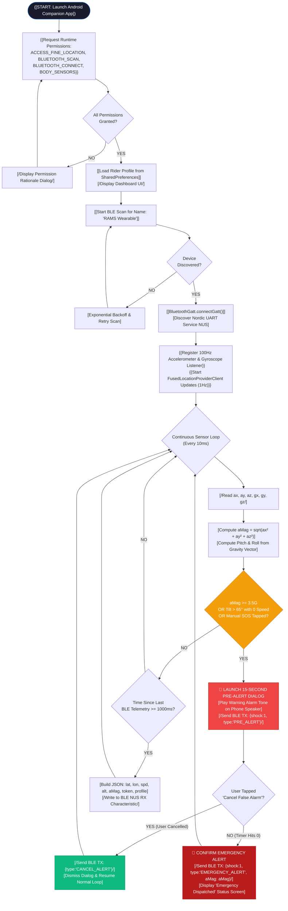

---

## 6. Slide Presentation Notes & Explanations (For Presenter / Defense)

### Slide 1: Program Flowchart Scope & Architecture
> *"Judges and panel members, this Program Flowchart specifies the algorithmic logic across all four software modules: the Wearable Embedded Firmware, the Receiver Gateway Firmware, the Desktop Command Center Engine, and the Android Sensing App. Each component operates asynchronously with rigorous validation and zero-blocking execution loops."*

### Slide 2: Wearable Firmware Algorithm & Crash Verification FSM
> *"Within the wearable node, the execution loop maintains a 5ms clock cycle. When the phone IMU detects an acceleration magnitude exceeding the 3.5G threshold, an interrupt-driven pre-alert is triggered. The program immediately initiates a 15-second grace window, pulsing the red NeoPixel and activating the buzzer. If the rider presses the hardware button or cancels via the smartphone UI, the firmware transitions into false alarm suppression, emits `PKT_FALSE_ALARM`, and resets. Only upon timer expiration without cancellation is `PKT_ALERT` dispatched over the LoRa radio."*

### Slide 3: Base Station Fail-Safe Ingestion Logic
> *"In the receiver gateway, LoRa packet reception takes highest priority. When a packet arrives, the receiver decodes the binary header and extracts the device token. If the base station has an active internet/LAN connection, it performs an immediate HTTP POST to the command server. If local WiFi is disconnected, the program invokes `localQueueAdd()`, safely writing the binary packet to LittleFS non-volatile flash memory. The background daemon continually polls the network and flushes the queue in FIFO sequence as soon as connectivity resumes, guaranteeing zero data loss."*
