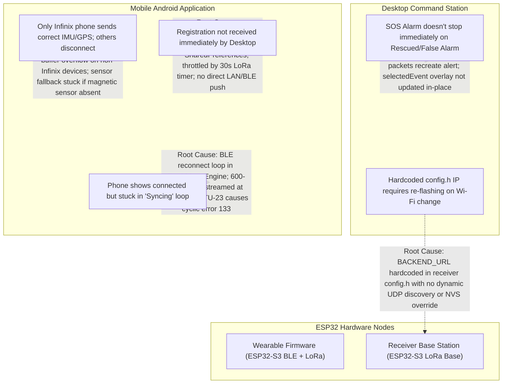

# Road Accident Monitoring System (RAMS) — Diagnostic & Fix Plan

> [!IMPORTANT]
> **Plan Only — No Code Execution**: In strict compliance with your instructions, no code has been modified. This document provides a complete root-cause diagnostic and an end-to-end fix blueprint across the Desktop App, Receiver Station, Wearable Firmware, and Android Application. Code execution will begin upon your command.

---

## 📋 Executive Summary of Issues & Root Causes

---

## 🔍 Detailed Root-Cause Analysis

### Issue 1: Desktop App — Rescued / False Alarm Does Not Stop SOS Alarms Immediately
* **Location in Code**:
  - [`desktop_app/Program.cs`](file:///d:/Antigravity/Projects/Danger%20Monitoring%20System%20V2/desktop_app/Program.cs#L858-L865) (`HandlePostRescue` and `ProcessContext`)
  - [`UI Redesign/src/components/RAMSWearableProfileOverlay.tsx`](file:///d:/Antigravity/Projects/Danger%20Monitoring%20System%20V2/UI%20Redesign/src/components/RAMSWearableProfileOverlay.tsx#L175-L220)
  - [`UI Redesign/src/App.tsx`](file:///d:/Antigravity/Projects/Danger%20Monitoring%20System%20V2/UI%20Redesign/src/App.tsx#L301-L355)
* **Root Cause**:
  1. **Partial Field Updates in Backend**: In [`desktop_app/Program.cs`](file:///d:/Antigravity/Projects/Danger%20Monitoring%20System%20V2/desktop_app/Program.cs#L947), `HandlePostRescue` replaced `"status":"RESCUED"`, but left `"type":"alert"`. In [`UI Redesign/src/types.ts`](file:///d:/Antigravity/Projects/Danger%20Monitoring%20System%20V2/UI%20Redesign/src/types.ts#L114-L120), `isEventActiveAlert()` checks `event.type === 'alert'`.
  2. **No Dedicated False Alarm Route**: `RAMSWearableProfileOverlay.tsx` posted False Alarms to `/api/upload` with `{ type: 'false_alarm' }`. In `Program.cs`, line 520 only matched if `evStatus.IndexOf("ALERT") >= 0`. High-G alerts with status `"CRITICAL HIGH-G IMPACT"` did not contain `"ALERT"`, causing the match to fail!
  3. **Packet Re-injection from Hardware Buffer**: When an incident occurs, the wearable and receiver retry queues continue broadcasting LoRa packets. When a subsequent packet from the same device token arrives, `ProcessIncomingPayload` re-inserted a new `"ACTIVE ALERT"` at index 0, re-triggering the alarm 2–3 seconds later!
  4. **Stale Overlay Component State**: In `App.tsx`, `ramsSelectedEvent` was not updated in-place when the user clicked Rescued or False Alarm. The modal kept displaying the stale `isAlert = true` badge until closed and re-opened.

---

### Issue 2: Receiver Station — IP Address Changes & Manual `config.h` Re-Flashing
* **Location in Code**:
  - [`receiver_withDesktop/config.h`](file:///d:/Antigravity/Projects/Danger%20Monitoring%20System%20V2/receiver_withDesktop/config.h#L41-L44)
  - [`receiver_withDesktop/http_upload.cpp`](file:///d:/Antigravity/Projects/Danger%20Monitoring%20System%20V2/receiver_withDesktop/http_upload.cpp)
  - [`receiver_withDesktop/wifi_manager.cpp`](file:///d:/Antigravity/Projects/Danger%20Monitoring%20System%20V2/receiver_withDesktop/wifi_manager.cpp)
* **Root Cause**:
  1. `BACKEND_URL` is hardcoded as a C preprocessor macro (`#define BACKEND_URL "http://10.146.164.180:8888"`).
  2. Whenever the PC changes Wi-Fi (e.g. from home to mobile hotspot or university network), the PC gets a new DHCP address. The receiver is completely unaware of this change and keeps sending HTTP POSTs to the old IP, causing timeouts.
  3. The receiver has no dynamic UDP discovery listener or NVS storage for the backend IP address, forcing a complete Arduino IDE re-flash every time.

---

### Issue 3: Mobile App — Only Infinix Phone Works; Other Phones Disconnect / No IMU / Inaccurate GPS
* **Location in Code**:
  - [`android_app/app/src/main/java/com/example/sync/Esp32SyncEngine.kt`](file:///d:/Antigravity/Projects/Danger%20Monitoring%20System%20V2/android_app/app/src/main/java/com/example/sync/Esp32SyncEngine.kt#L398-L415)
  - [`android_app/app/src/main/java/com/example/sensor/PhoneSensorEngine.kt`](file:///d:/Antigravity/Projects/Danger%20Monitoring%20System%20V2/android_app/app/src/main/java/com/example/sensor/PhoneSensorEngine.kt#L143-L157)
* **Root Cause**:
  1. **Android BLE Concurrency Violation (MTU Request vs Descriptor Write)**:
     - In `onServicesDiscovered`, the code calls `gatt.writeDescriptor(...)` and immediately executes `gatt.requestMtu(512)` without waiting for `onDescriptorWrite`.
     - Standard Android BLE stacks (Samsung, Xiaomi, Pixel) reject concurrent GATT operations, returning `false` / error 133.
     - As a result, MTU negotiation fails and remains at default **23 bytes** (payload: 20 bytes).
     - Infinix/MediaTek devices have custom driver queuing that masked this, but on all other phones it breaks.
  2. **HCI Buffer Saturation & Disconnection**:
     - `buildTelemetryPacket()` generates a **~600-byte JSON string** containing the full rider registration, Google Drive links, URLs, and IMU data.
     - At MTU 23, 600 bytes requires **30 consecutive BLE write chunks**.
     - With 30 chunks * 25ms delay = **750ms**, but the streaming loop fires every **100ms** (10Hz)!
     - Android's Bluetooth HCI controller queue quickly overflows, throwing `GATT_BUSY` and terminating the link (`HCI Disconnect status 8 / 19`).
  3. **Sensor Fallback Deadlock in `PhoneSensorEngine`**:
     - Line 256: `pitchDegrees = if (!hasGravity) pitchRad * RAD_TO_DEG else _phoneImuState.value.pitchDegrees`.
     - Many phones have `Sensor.TYPE_GRAVITY`, setting `hasGravity = true`. But if the phone lacks a hardware compass (`Sensor.TYPE_MAGNETIC_FIELD`), `updateOrientationIfReady()` never executes!
     - Pitch and Roll remain locked at `0.0°` permanently.
  4. **GPS Accuracy Clobbering**:
     - `PhoneSensorEngine` registers `GPS_PROVIDER`, `NETWORK_PROVIDER`, and `PASSIVE_PROVIDER`.
     - Line 190: `if (bestLoc == null || loc.time > bestLoc.time || ...)` evaluates `loc.time > bestLoc.time` first.
     - A coarse cellular network fix (accuracy ±1,500m) with a fresh timestamp completely overwrites high-precision GPS fixes!

---

### Issue 4: Mobile App — Registration Not Received Immediately by Desktop App
* **Location in Code**:
  - [`android_app/app/src/main/java/com/example/viewmodel/RamsViewModel.kt`](file:///d:/Antigravity/Projects/Danger%20Monitoring%20System%20V2/android_app/app/src/main/java/com/example/viewmodel/RamsViewModel.kt#L521-L525)
  - [`wearable_withApp/bt_service.cpp`](file:///d:/Antigravity/Projects/Danger%20Monitoring%20System%20V2/wearable_withApp/bt_service.cpp#L92-L94)
* **Root Cause**:
  1. In `RamsViewModel.kt`, `saveRiderProfile()` only writes to local `SharedPreferences`. It **never** triggers an immediate BLE transmission or network HTTP POST!
  2. In `wearable_withApp/bt_service.cpp`, `PROFILE_BROADCAST_INTERVAL_MS = 30000` throttled profile broadcasts to once every 30 seconds over LoRa.
  3. If BLE dropped or was delayed, the desktop never received the registration until an alert occurred.

---

### Issue 5: Mobile App — Stuck in "Syncing" State & Prone to Disconnections
* **Location in Code**:
  - [`android_app/app/src/main/java/com/example/ui/screens/WearableScreen.kt`](file:///d:/Antigravity/Projects/Danger%20Monitoring%20System%20V2/android_app/app/src/main/java/com/example/ui/screens/WearableScreen.kt#L773-L815)
  - [`android_app/app/src/main/java/com/example/sync/Esp32SyncEngine.kt`](file:///d:/Antigravity/Projects/Danger%20Monitoring%20System%20V2/android_app/app/src/main/java/com/example/sync/Esp32SyncEngine.kt#L346-L373)
* **Root Cause**:
  1. `WearableScreen.kt` displays `"Syncing"` under the device title even when connected, and the button label displays `"SYNCING"` with a spinner whenever `isConnecting` is true.
  2. Because of Issue 3, non-Infinix phones disconnect within 1–2 seconds. The auto-reconnect logic in `Esp32SyncEngine` immediately triggers a new connection attempt after 3 seconds, putting the app into a perpetual, unescapable `Connect -> Overrun -> Disconnect -> Reconnect` loop.
  3. The connect button was disabled (`enabled = !isConnecting`), preventing the user from cleanly cancelling the connection.

---

## 🛠️ Step-by-Step Fix Plan

### Module 1: Desktop Application (`desktop_app/` & `UI Redesign/`)

#### 1.1 Backend API Enhancements (`desktop_app/Program.cs`)
- **Implement Dedicated `/api/events/false-alarm` & `/api/false-alarm`**:
  - Accept `{ id: string, deviceToken: string }`.
  - Atomically update all matching incidents: `"status":"FALSE ALARM"` AND `"type":"false_alarm"`.
- **Enhance `/api/events/rescue` & `/api/rescue`**:
  - Atomically update `"status":"RESCUED"` AND `"type":"rescued"`.
- **Implement 60-Second Alert Suppression Cooldown**:
  - When an incident is cleared (False Alarm or Rescued), record `(deviceToken, timestamp)` in an in-memory suppression map.
  - If subsequent LoRa packets for this token arrive within 60 seconds (from hardware retry queues), update their coordinates/telemetry but do **not** re-elevate status to `ACTIVE ALERT` or `CRITICAL HIGH-G IMPACT`.
- **Zero-Config UDP Auto-Discovery Service**:
  - Start a background UDP listener on port `8889`.
  - When a broadcast packet `"RAMS_DISCOVER_SERVER"` is received, reply to the sender with:
    `{"status":"RAMS_DESKTOP","ip":"<CURRENT_LAN_IP>","port":8080,"lanPort":8888}`.
  - Automatically adapts to any IP change without human intervention.

#### 1.2 Frontend Instant State Synchronization (`UI Redesign/`)
- In [`RAMSWearableProfileOverlay.tsx`](file:///d:/Antigravity/Projects/Danger%20Monitoring%20System%20V2/UI%20Redesign/src/components/RAMSWearableProfileOverlay.tsx):
  - In `handleMarkRescued` and `handleMarkFalseAlarm`, update the local component state immediately (`event.status = 'RESCUED'`, `event.type = 'rescued'`).
  - Route false alarm calls to `/api/events/false-alarm`.
- In [`App.tsx`](file:///d:/Antigravity/Projects/Danger%20Monitoring%20System%20V2/UI%20Redesign/src/App.tsx):
  - In `fetchEvents()`, synchronize `ramsSelectedEvent` with the newly fetched list so open overlays update instantly without requiring close/reopen.
- Re-bundle `UI Redesign` via `npm run build` and sync to `desktop_app/www/`. Recompile `RAMS_Rescuer_Desktop.exe`.

---

### Module 2: Receiver Base Station (`receiver_withDesktop/`)

#### 2.1 Dynamic Backend URL with UDP Auto-Discovery & NVS Storage
- **NVS-Backed Backend URL (`nvs_store.cpp`, `nvs_store.h`)**:
  - Add `nvsGetBackendUrl()` and `nvsSetBackendUrl(url)`.
- **UDP Broadcast Auto-Discovery (`http_upload.cpp`, `receiver_withDesktop.ino`)**:
  - After Wi-Fi connection is established, broadcast UDP ping `"RAMS_DISCOVER_SERVER"` to `255.255.255.255:8889`.
  - When the desktop responds, parse the desktop IP and update `BACKEND_URL` in memory.
  - Fall back to NVS saved URL, and then to `config.h` default.
- **Captive Portal Dynamic IP Field (`wifi_manager.cpp`)**:
  - Add a "Desktop Server IP / URL" field to the captive portal configuration page (`RAMS_Receiver_Setup`) so users can also configure it manually from any phone browser without re-flashing.

---

### Module 3: Mobile Android Application (`android_app/`)

#### 3.1 Robust Sequential BLE GATT Link (`Esp32SyncEngine.kt`)
- **Strictly Sequential BLE Initialization**:
  1. `connectGatt` -> Wait for `STATE_CONNECTED`.
  2. Request MTU 512 -> Wait for `onMtuChanged` callback.
  3. Call `discoverServices()` -> Wait for `onServicesDiscovered`.
  4. Enable TX characteristic notifications and write client config descriptor -> Wait for `onDescriptorWrite`.
  5. Mark `isSyncActive = true`, complete latch, and start streaming loop.
- **Lightweight High-Frequency Telemetry vs. Separate Profile Sync**:
  - Split the current 600-byte bloated packet into:
    1. **High-Frequency Stream (10Hz)**: Compact JSON under 120 bytes (`{"type":"TEL","t":..,"lat":..,"lon":..,"spd":..,"ax":..,"ay":..,"az":..,"amag":..,"gx":..,"gy":..,"gz":..,"pitch":..,"roll":..,"shock":..}`).
    2. **Rider Profile Packet (One-Shot / On-Demand)**: Sent once upon connection and whenever profile is modified (`{"type":"REGISTER", ...}`).
- **Eliminate Cyclic Disconnect Loop**:
  - Increase retry backoff with a maximum retry counter (3 attempts) before showing an explicit "RECONNECT" button instead of locking the UI in infinite auto-reconnect.

#### 3.2 Universal Sensor Engine & GPS Fix (`PhoneSensorEngine.kt`)
- **Guaranteed Accelerometer Tilt Fallback**:
  - Always compute pitch and roll from accelerometer gravity vector:
    `pitch = atan2(accelY, sqrt(accelX^2 + accelZ^2)) * 180 / PI`
    `roll = atan2(-accelX, accelZ) * 180 / PI`
  - If rotation vector or geomagnetic sensor is present, fuse them; if absent, use pure accelerometer tilt. Never leave pitch/roll at `0.0°`.
- **GPS Satellite Priority & Accuracy Gate**:
  - Only accept `NETWORK_PROVIDER` if no GPS fix exists or if the last GPS fix is older than 15 seconds.
  - Reject any location update with accuracy worse than 50 meters if an accurate GPS fix is active.

#### 3.3 Instant Rider Registration Dispatch (`RamsViewModel.kt`)
- When `saveRiderProfile(profile)` is called:
  1. Save locally to SharedPreferences.
  2. Immediately transmit a high-priority `REGISTER` payload over BLE to the wearable.
  3. If the phone is on the local Wi-Fi or connected to desktop LAN, dispatch an asynchronous HTTP POST directly to `http://<DESKTOP_IP>:8080/api/register`.

#### 3.4 UI Clarity & Control (`WearableScreen.kt`)
- Replace ambiguous `"Syncing"` text with explicit states:
  - `CONNECTED` (Green): BLE GATT link established, data streaming normally.
  - `CONNECTING...` (Blue): Establishing link.
  - `DISCONNECTED` (Gray): Offline.
- Ensure the Connect/Disconnect button remains clickable so the user can abort a connection attempt at any time.

---

### Module 4: Wearable Firmware (`wearable_withApp/`)

#### 4.1 Immediate LoRa Dispatch on Registration
- In [`wearable_withApp/bt_service.cpp`](file:///d:/Antigravity/Projects/Danger%20Monitoring%20System%20V2/wearable_withApp/bt_service.cpp):
  - When an incoming `REGISTER` or `RIDER_PROFILE` BLE message arrives from the phone, immediately transmit a `PKT_RIDER_PROFILE` packet over LoRa without waiting for the 30-second interval timer.
  - On `CANCEL_ALERT`, immediately stop the buzzer, set NeoPixel to armed, and send `PKT_FALSE_ALARM` via LoRa.

---

## 🔬 Testing & Verification Matrix

| Component | Test Case | Success Criteria |
| :--- | :--- | :--- |
| **Desktop App** | Click "Rescued" button on active incident | Status changes immediately to RESCUED; type becomes 'rescued'; alert count decrements to 0; subsequent LoRa retries do not re-trigger alert |
| **Desktop App** | Click "False Alarm" button on high-G impact | Status changes immediately to FALSE ALARM; badge turns green; SOS alert clears |
| **Receiver Base** | Change Wi-Fi network / change Desktop IP | Receiver auto-discovers new Desktop IP via UDP within 1s; no code re-compilation or re-flashing required |
| **Mobile App (Other Phones)** | Connect Samsung / Xiaomi / Pixel via BLE | Connects cleanly without error 133; MTU negotiates to 512; data streams continuously at 10Hz without disconnection |
| **Mobile App (Sensors)** | Tilt phone without gyro / compass | Pitch and roll update smoothly on attitude indicator and telemetry graphs |
| **Mobile App (GPS)** | Indoors vs Outdoors GNSS test | GPS satellite coordinates prioritized; coarse network fixes do not jump the map pin |
| **Registration** | Save rider profile on phone | Profile transmitted instantly over BLE and reflects on desktop rescuer dispatch dashboard |

---

## 🚦 Awaiting Your Command
This plan covers every aspect of the reported issues. Once you review and approve this plan, reply with **"execute"** or specify any adjustments, and implementation will commence across the modules.
