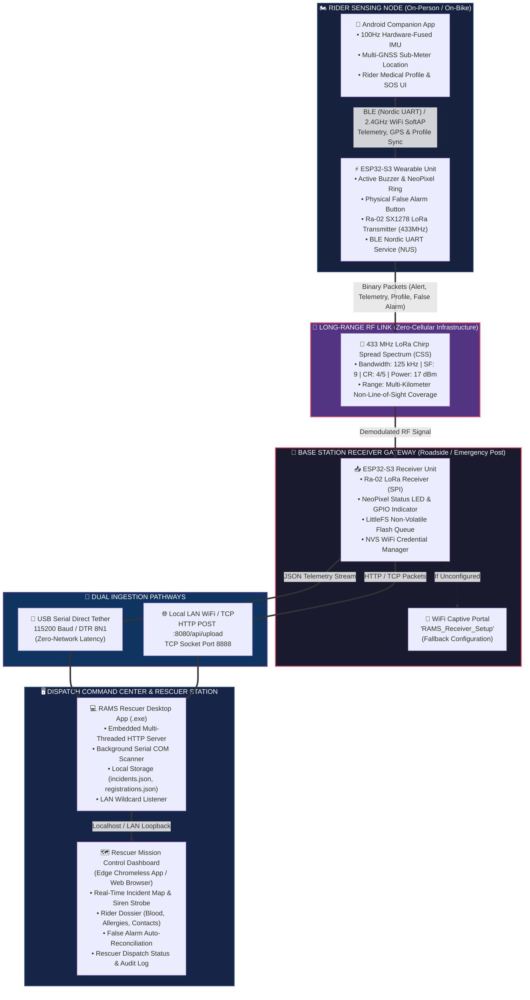
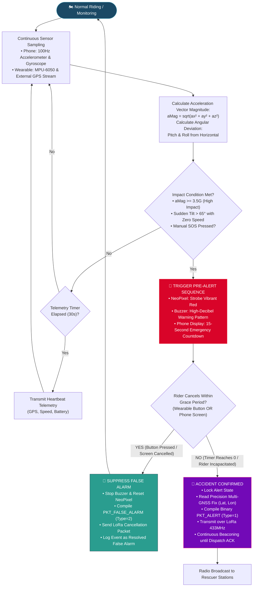
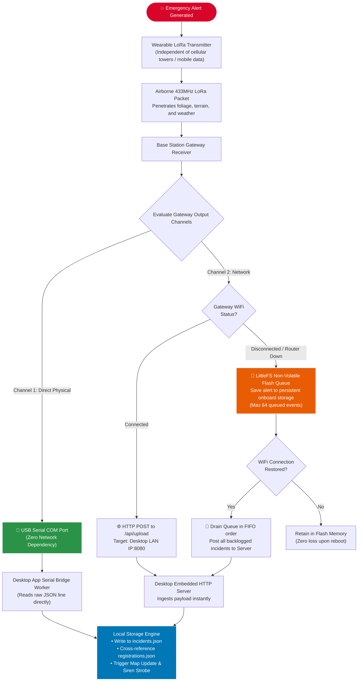
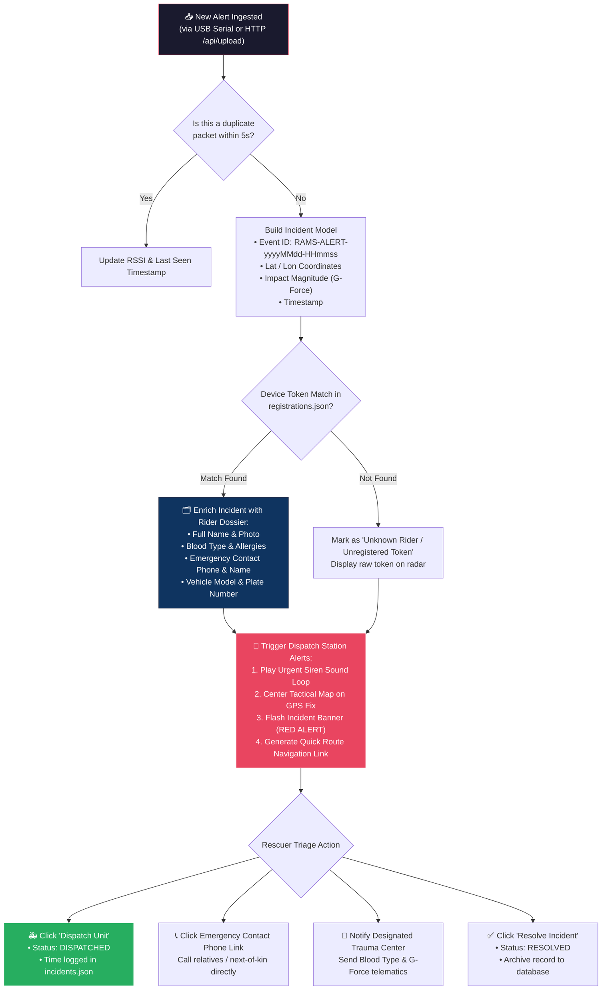
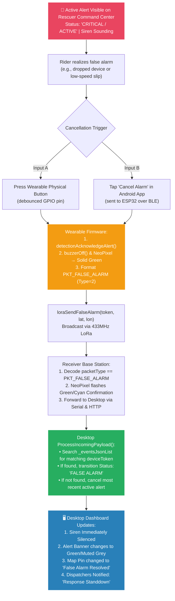
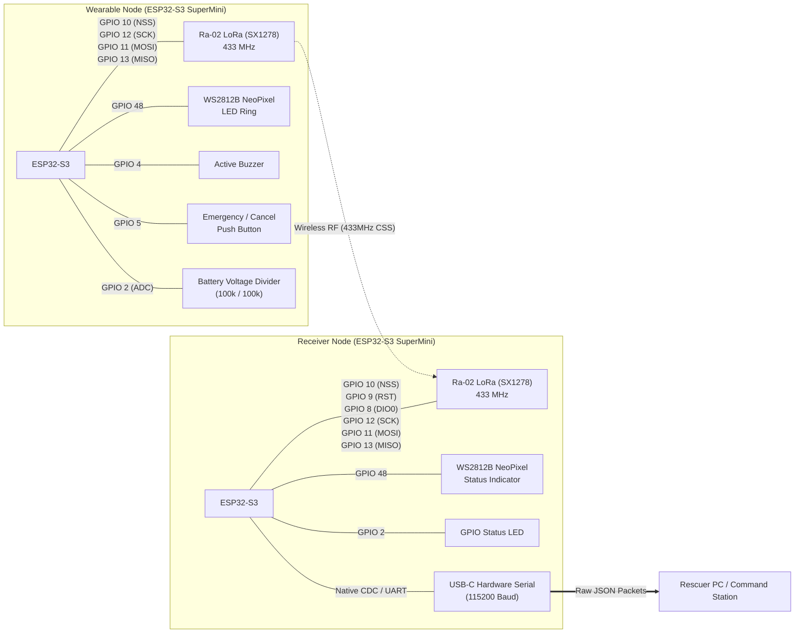

# RAMS — Whole System Flowchart

> **Road Accident Monitoring System (RAMS) — End-to-End System Architecture & Operational Workflows**  
> *Presentation & System Defense Reference Guide*  
> *Source Codebase: `Working Code - Do Not Touch/Road-Accident-Monitoring-System-main/`*

---

## 1. High-Level System Architecture & Ecosystem Topology

The **Road Accident Monitoring System (RAMS)** is an integrated IoT-RF emergency response network designed to eliminate the fatal delay between a motorcycle or vehicular crash and emergency medical response, particularly in suburban, rural, or cellular dead zones.

---

## 2. End-to-End Operational Lifecycle Flow

The complete chronological lifecycle of the system from rider prep to emergency resolution:

```mermaid
sequenceDiagram
    autonumber
    actor Rider as 🏍️ Rider
    participant Phone as 📱 Android App
    participant Wearable as ⚡ Wearable ESP32
    participant LoRa as 📡 LoRa 433MHz
    participant Receiver as 📥 Receiver ESP32
    participant Desktop as 🖥️ Desktop Command Center
    actor Rescuer as 🚑 Rescuer / Dispatcher

    %% Phase 1: Pairing & Setup
    rect rgb(24, 32, 54)
    Note over Rider, Desktop: PHASE 1: SYSTEM INITIALIZATION & BLE ARMING
    Rider->>Phone: Open RAMS App, Fill Rider Profile (Blood, Contacts, Plate)
    Phone->>Wearable: BLE Connect (Nordic UART Service)
    Wearable-->>Phone: Confirm Connection (NeoPixel Turns Solid Green)
    Phone->>Wearable: Sync GPS & Rider Profile JSON
    Wearable->>LoRa: loraSendRiderProfile() [233-byte profile packet]
    LoRa->>Receiver: Packet Received & Decoded
    Receiver->>Desktop: Ingest Profile (Serial/HTTP) -> Cache to registrations.json
    end

    %% Phase 2: Cruising Telemetry
    rect rgb(20, 45, 60)
    Note over Rider, Desktop: PHASE 2: ACTIVE MONITORING & TELEMETRY
    loop Every 30 Seconds
        Phone->>Wearable: Send GPS Fix (Lat, Lon, Speed, Altitude)
        Wearable->>LoRa: loraSendTelemetry(Token, Lat, Lon, Battery%)
        LoRa->>Receiver: Forward Telemetry
        Receiver->>Desktop: Update Live Tracking Map
    end
    end

    %% Phase 3: Impact & Pre-Alert Grace Window
    rect rgb(60, 20, 30)
    Note over Rider, Desktop: PHASE 3: IMPACT DETECTION & FALSE ALARM SUPPRESSION
    Rider->>Phone: High-G Crash / Fall Incident Occurs!
    Phone->>Phone: IMU detects aMag > Threshold (or MPU-6050 Shock)
    Phone->>Wearable: BLE Alert Signal (shock=1, aMag)
    Wearable->>Wearable: NeoPixel FLASH RED, Loud Buzzer Alarm Sounds!
    Note over Rider, Wearable: Pre-Alert Grace Period (Rider has opportunity to cancel)
    
    alt Rider Cancels (Minor Drop / False Alarm)
        Rider->>Wearable: Press Physical Hardware Button (or Phone "Cancel" button)
        Wearable->>Wearable: Buzzer Silenced, NeoPixel returns to Armed Green
        Wearable->>Phone: BLE Cancel Ack
        Wearable->>LoRa: loraSendFalseAlarm(Token, Lat, Lon)
        LoRa->>Receiver: False Alarm Packet
        Receiver->>Desktop: Ingest False Alarm Event
        Desktop->>Desktop: Mark Active Incident as "FALSE ALARM / DISMISSED"
    else Grace Period Expires (Unconscious / Real Severe Crash)
        Note over Wearable, Rescuer: CRASH CONFIRMED: IMMEDIATE ESCALATION
        Wearable->>LoRa: loraSendAlert(Token, Lat, Lon, aMag, EventType)
        LoRa->>Receiver: Emergency Packet Transmitted (SF9 433MHz)
        Receiver->>Receiver: NeoPixel Red Strobe, Status LED Rapid Blink
        
        alt WiFi Connected
            Receiver->>Desktop: HTTP POST /api/upload (Immediate Alert)
        else WiFi Down
            Receiver->>Receiver: Buffer Alert to LittleFS Offline Queue
            Note over Receiver: Retries upload until network restores
        end

        Receiver->>Desktop: Serial COM Stream: Raw JSON Alert Packet
        Desktop->>Desktop: Play Siren Alert, Pinpoint GPS Coordinates on Radar Map
        Desktop->>Desktop: Enrich with Rider Medical Profile (Blood type, Emergency contact, Photo)
        Desktop->>Rescuer: Display Priority Alert Screen with Route & Triage Data
        Rescuer->>Desktop: Click "Acknowledge & Dispatch Response Unit"
    end
    end
```

---

## 3. Crash Detection & State Machine Flow

The decision-making hierarchy inside the sensing unit (Phone IMU + Wearable ESP32):

---

## 4. Multi-Layer Fail-Safe & Network Redundancy Flow

How the system guarantees zero data loss even during complete infrastructure failure:

---

## 5. Rescuer Command Center & Dispatch Flow

The operational flow on the Rescuer Desktop Application upon receiving an incident:

---

## 6. False Alarm Reconciliation Flow

How accidental triggers (dropping a phone, pothole bump) are cleanly cancelled without wasting municipal emergency resources:

---

## 7. System Hardware Interconnection & Pinout Map

Schematic summary of all physical hardware interfaces across both nodes:

---

## 8. Summary Comparison of System Operational States

| System State | Wearable NeoPixel | Wearable Buzzer | Receiver NeoPixel | Desktop Dashboard Status | Rescuer Action Required |
|:---|:---|:---|:---|:---|:---|
| **Boot / Init** | Pulsing Cyan | Single Chirp | Pulsing Blue | Ready / Standby | None (Self-test) |
| **Armed & Cruising** | Solid Green | Silent | Solid Green (Online) | Live Tracking (Normal) | Monitoring routine telemetry |
| **Pre-Alert (Crash Suspected)** | Flashing Red (Fast) | Urgent Strobe Beep | Solid Green | No alert yet (Grace window) | Rider given 15s to cancel |
| **Confirmed Crash Alert** | Strobe Bright Red | Continuous Siren | Strobe Bright Red | **CRITICAL RED ALERT** | **Immediate Medical Dispatch** |
| **False Alarm Cancelled** | Solid Green | Double Confirm Chirp | Strobe Cyan/Green | Muted Grey ("False Alarm") | Stand down response unit |
| **RF / LoRa Disconnected** | Solid Red | Long Error Tone | Solid Yellow (Offline) | Warning: "Node Inactive" | Investigate node signal range |

---

*Generated from verified implementation in `Working Code - Do Not Touch/Road-Accident-Monitoring-System-main/`*
