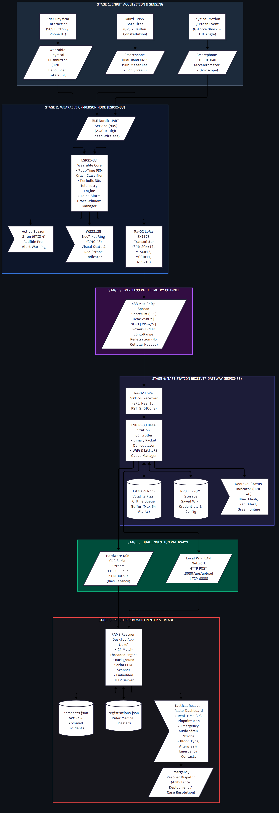
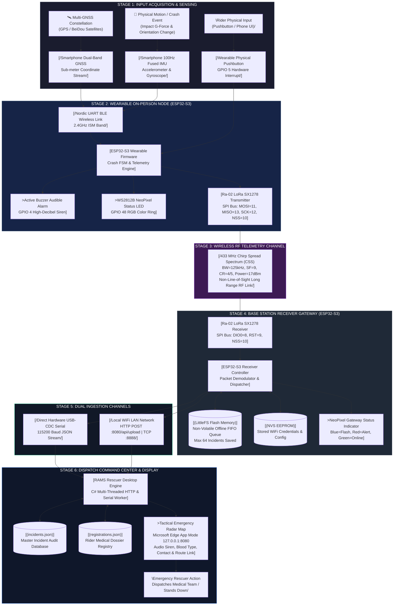
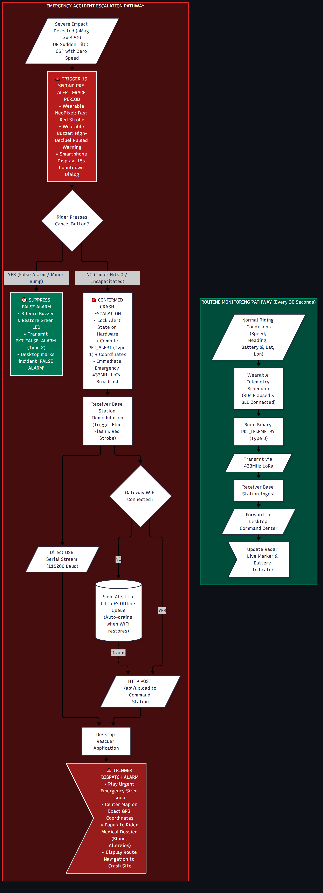
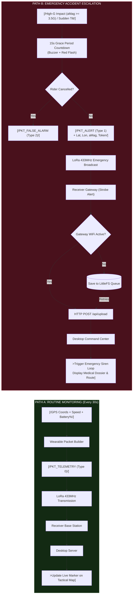
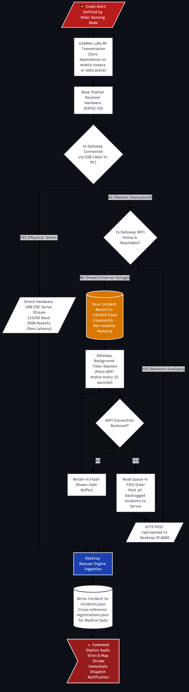
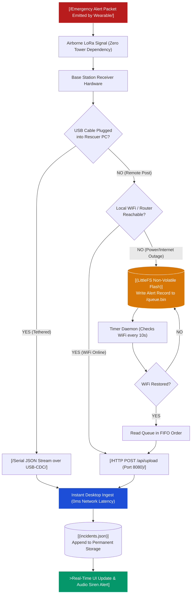

# RAMS — System Flowchart (System Architecture & Data Flow)

> **Road Accident Monitoring System (RAMS)**  
> **Formal System Flowchart for Presentation Slides, Project Documentation, and Defense**  
> *Reference Codebase: `Working Code - Do Not Touch/Road-Accident-Monitoring-System-main/`*  
> *Target Competition/Defense: PGC Digital Innovation Challenge / Capstone Engineering*

---

## 1. Overview & System Flowchart Definition

A **System Flowchart** illustrates the physical flow of data, control signals, and operations across all physical hardware entities, communication channels, storage media, and human interfaces in the entire ecosystem.

### Standard System Flowchart Symbols Used:
- `[/Input / Output / Data/]` — External signals, sensor feeds, user inputs, and transmitted packets.
- `[System Process]` — Microcontroller execution, data transformation, or server computation.
- `[(Direct Access Storage)]` — Non-volatile storage (LittleFS flash, NVS memory, local JSON database).
- `[\Manual Input / Operation/]` — Physical button presses, user UI interactions.
- `>Display / Audio Output]` — NeoPixel illumination, buzzer alarms, tactical map visual alerts.
- `{Decision / Conditional Gateway}` — Hardware/network state evaluation.

---

## 2. Master System Flowchart (End-to-End Hardware & Data Flow)

> **High-Resolution Formats:**  
> • [Download Vector SVG](graphics/System_Flowchart_Master.svg) *(infinite resolution zoom for posters/slides)*  
> • [Download 300 DPI PNG](graphics/System_Flowchart_Master.png) *(ready for PowerPoint / Canva / Google Slides)*

<b>Click to View Mermaid Source Code</b>

---

## 3. Subsystem Data Flow: Normal Telemetry vs. Emergency Crash Incident

> **High-Resolution Formats:**  
> • [Download Vector SVG](graphics/System_Flowchart_Routine_vs_Crash.svg)  
> • [Download 300 DPI PNG](graphics/System_Flowchart_Routine_vs_Crash.png)

<b>Click to View Mermaid Source Code</b>

---

## 4. Subsystem Data Flow: Zero-Cellular Resilience & Storage Failover

> **High-Resolution Formats:**  
> • [Download Vector SVG](graphics/System_Flowchart_Storage_Failover.svg)  
> • [Download 300 DPI PNG](graphics/System_Flowchart_Storage_Failover.png)

<b>Click to View Mermaid Source Code</b>

---

## 5. Slide Presentation Notes & Explanations (For Presenter / Defense)

### Slide 1: System Flowchart Overview
> *"Judges/Panel, this System Flowchart illustrates the end-to-end data lifecycle of the Road Accident Monitoring System across all physical layers. The system is split into six clear stages: Input Acquisition, Wearable Edge Processing, LoRa Telemetry, Base Station Ingestion, Dual Ingestion Channels, and the Rescuer Command Center."*

### Slide 2: Eliminating the Cellular Bottleneck
> *"Unlike commercial smartwatches that depend on an expensive mobile data plan and active cellular towers, RAMS utilizes an onboard 433 MHz LoRa transceiver. Sensor data processed at the edge is packetized and transmitted directly over radio frequency, penetrating foliage and terrain to reach rural health units or roadside rescue posts up to several kilometers away."*

### Slide 3: Dual-Channel Redundancy & Zero Data Loss
> *"At the base station, data redundancy is built into the architecture. In a stationary deployment, the receiver connects directly to the rescuer laptop via USB-CDC serial, ensuring zero network latency. If placed on a high antenna tower, it transmits over WiFi LAN. Should local power or router connectivity fail, an onboard LittleFS non-volatile flash queue buffers all emergency records until reconnection, guaranteeing zero lost accident reports."*
