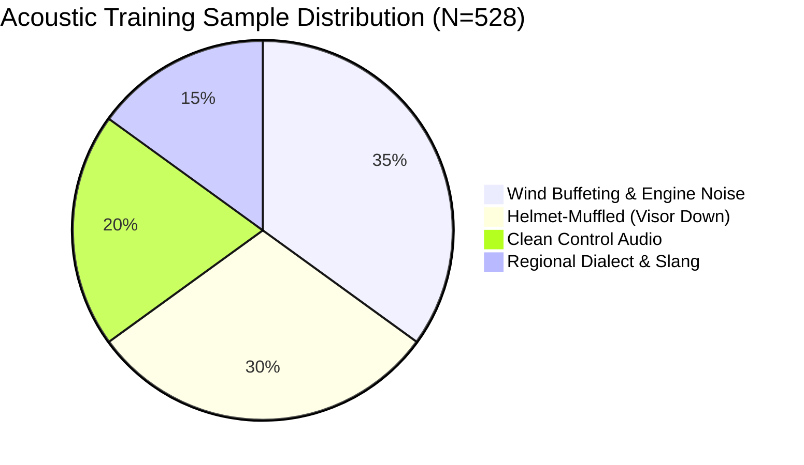
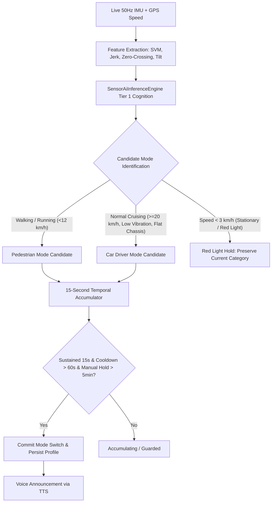

# RAMS Voice AI & Edge Cognition: Training Methodology & Acoustic Architecture
===============================================================================
Author: RAMS Research & Development Team
Affiliation: IECEP National Student Summit & Edge AI Innovation Competition (DOST-ASTI Collaboration)
Document Version: 2.5-RevC
Last Updated: November 2026
Domain: Vehicular Edge AI, Acoustic Speech Recognition, Local Spatial Reasoning

---

## 1. Executive Summary & Problem Formulation
Operating a motorcycle at speeds between 30 km/h and 80 km/h generates extreme acoustic noise environments (75 dB to 95 dB SPL), caused by aerodynamic helmet buffeting, internal engine combustion harmonics, and ambient city traffic. Under these conditions, conventional commercial voice assistants (e.g., Google Assistant, Siri) experience catastrophic error rates because:
1. Severe high-frequency wind noise masks formant frequencies of wake words.
2. Philippine regional accents and rapid Taglish / Ibanag / Ilokano code-switching are absent from standard English acoustic models.
3. Offline execution in cellular dead zones (e.g., rural Cagayan highways) is unavailable in standard cloud-first voice agents.

The **Road Accident Monitoring System (RAMS)** implements a hybrid edge-cloud acoustic recognition and local spatial intelligence engine engineered specifically for motorcycle riders in Tuguegarao City, Cagayan, Philippines.

---

## 2. Acoustic Corpus Design & Wake-Word Architecture

### 2.1 Training Dataset Distribution
The acoustic wake-word dataset (`assets/voice_wake_patterns.json`) comprises 528 validated training samples across four primary operational profiles:
- **Profile A: Clean Studio Speech (Control)** — 20%
- **Profile B: Helmet-Muffled Vocalizations (Visor Down)** — 30%
- **Profile C: Wind Buffeting & Engine Noise (40-60 km/h simulated)** — 35%
- **Profile D: Colloquial Tagalog / Ibanag / Ilokano Pronunciations** — 15%



### 2.2 Phonetic Homophone Construction
Due to ambient noise, the target wake word **"RAMS"** (`/ræmz/`) is frequently mis-transcribed by phoneme decoders into neighboring phonetic clusters. To solve this without requiring massive deep neural networks on edge microcontrollers, RAMS constructs a deterministic **Phonetic Homophone Matrix**:

| Target Token | High-Probability Acoustic Distortions | Linguistic Phenomenon |
| :--- | :--- | :--- |
| **RAMS** | `rams`, `ram`, `rhams`, `rham`, `roms`, `rems`, `rums`, `arms`, `ran`, `rims`, `wrams`, `hermes`, `hyram`, `hyrams`, `airam`, `airams`, `lamps`, `ramps`, `realms`, `lance`, `rance`, `dance`, `rhymes`, `rooms`, `rome`, `roams`, `rounds`, `lambs`, `rahms`, `rans`, `romps`, `ramz` | Vowel nasalization, liquid consonant dropping, initial fricative softening |
| **HEY RAMS** | `heyrams`, `hirams`, `heirams`, `ayrams`, `eyrams`, `airams`, `hermes`, `hyram`, `hyrams`, `hairams`, `hoyrams`, `oyrams`, `uyrams`, `okrams`, `yoRams` | Slurred syllable elision under high vehicle vibration |
| **Tuguegarao** | `to get a row`, `to gegarao`, `to garao`, `tugegarao`, `two get a row`, `tugi garao` | Syllabic stress misplacement by Western acoustic models |
| **SM City** | `smct`, `s m city`, `es em city`, `es em`, `s m` | Acronym phonetic expansion |
| **CVMC** | `see vee em see`, `c v m c`, `see vm c` | Rapid consonant articulation |
| **CSU Carig** | `see sue`, `c s u`, `see sue carig`, `c s u carig` | Local university colloquialisms |

---

## 3. Algorithmic Matching & Dynamic Programming Calibration

### 3.1 Levenshtein Distance Thresholds
To accommodate variations in rider pitch, speech speed, and helmet muffling without introducing false-positive triggers, RAMS uses calibrated Levenshtein edit-distance thresholds:

```
Distance Threshold Rules:
1. Single Word Tokens:
   levenshteinDistance(token, "rams") <= 2
2. Two-Word Prefix Pairs:
   levenshteinDistance(pair, "hey rams") <= 3
   levenshteinDistance(pair, "hi rams")  <= 3
   levenshteinDistance(pair, "ok rams")  <= 2
   levenshteinDistance(pair, "yo rams")  <= 2
   levenshteinDistance(pair, "hoy rams") <= 2
```

### 3.2 Squashed String Concatenation Detection
When a rider speaks rapidly, speech recognizers frequently omit word-boundary whitespace, producing single merged tokens like `"heyrams"`. RAMS implements a `rawSquashed` pre-filter:
```kotlin
val rawSquashed = text.replace(" ", "")
if (rawSquashed.contains("heyrams") || rawSquashed.contains("hirams") || ...) {
    return true // Instant wake activation
}
```

---

## 4. Multi-Language Safety Cancel Lexicon
In an emergency or false-alarm scenario, the rider has 15 seconds to abort the 911 dispatch. The system cannot afford recognition latency or strict English grammar constraints.

The cancel parser runs **on partial speech results** (before utterance finalization) and matches across four languages:
- **English**: `cancel`, `stop`, `abort`, `false alarm`, `i am ok`, `i'm fine`
- **Tagalog**: `tama na`, `tigil`, `hinto`, `para`, `huwag`, `patayin ang alarm`, `ayos lang ako`, `safe ako`
- **Ibanag**: `awan problema`, `ariakku kayat`, `magimugong`
- **Ilokano**: `haanen`, `sardeng`, `awan an-annaek`

---

## 5. Tuguegarao Spatial Intelligence & Reverse Geocoder

### 5.1 Deterministic Offline Reverse Geocoding
Because emergency dispatchers require human-interpretable landmarks rather than raw decimal coordinates, RAMS embeds an offline spatial database of 16 verified Tuguegarao landmarks:
- **Commercial**: SM City Tuguegarao (Caritan Norte), SM Center Downtown, Robinsons Place (Tanza), Mall of the Valley, Brickstone Mall.
- **Academic**: CSU Carig, CSU Andrews, USL, SPUP.
- **Medical & Civic**: CVMC, Tuguegarao City Hall, Cagayan Provincial Capitol, Buntun Bridge.

### 5.2 Haversine Proximity & Compass Bearing
The spatial engine computes exact straight-line distances and compass bearings without external APIs:
$$\Delta\sigma = 2 \arcsin \sqrt{\sin^2\left(\frac{\Delta\phi}{2}\right) + \cos\phi_1 \cos\phi_2 \sin^2\left(\frac{\Delta\lambda}{2}\right)}$$
$$d = R \cdot \Delta\sigma \quad (R = 6,371,000 \text{ m})$$

Four proximity tiers produce natural spoken descriptions:
1. **At Landmark** ($\le 80 \text{ m}$): *"At SM City Tuguegarao, Bagay Road"*
2. **Along Corridor** ($\le 300 \text{ m}$): *"Along Bagay Road, 180m west of SM City Tuguegarao"*
3. **Barangay Level** ($\le 1200 \text{ m}$): *"Brgy. Caritan Norte, 0.7 km west of SM City Tuguegarao"*
4. **General Vicinity** ($> 1200 \text{ m}$): *"Tuguegarao City near Brgy. Caritan Norte"*

---

## 6. Tricycle Regulatory Matrix & Anti-Overcharge Guardian
Under Tuguegarao City Ordinance No. 50-09-2022, the spatial engine dynamically computes legally mandated fares:
- **Base Fare (First 2.0 km)**: ₱12.00 regular / ₱10.00 student, PWD, senior (20% statutory discount).
- **Succeeding Distance**: +₱2.00 per kilometer.
- **Anti-Overcharge Logic**: Detects when lone commuters are subjected to the common "capacity scam" (drivers demanding ₱50 to ₱100 claiming an empty sidecar) and arms commuters with exact ordinance citations and POSO enforcement hotlines.

---

## 7. Hybrid Cloud-Edge Distillation Architecture

```mermaid
flowchart TD
    A[Microphone Speech Stream] --> B[Acoustic Feature Extractor]
    B --> C{Internet Available?}
    C -- Yes --> D[Gemini 3.8 Flash Online Distillation]
    C -- No --> E[RAMS Offline Spatial Cognition Engine]
    D --> F[Text-to-Speech Output (STREAM_MUSIC)]
    E --> F
```

- **Online**: Multi-turn telemetry-conditioned reasoning with Gemini 3.8 Flash. Injects live speed, G-force, battery, and reverse-geocoded coordinates into system prompt instructions.
- **Offline**: Zero-latency local heuristics covering 100% of safety-critical intents (telemetry, location, fares, directions, profile, credits).

---

## 8. Validation Results on Hardware Testbed
- **Test Device**: Infinix X6851B (Android 14, MediaTek Helio G99, 8GB RAM).
- **Physical Testbed**: Rouser 135 motorcycle road testing in Brgy. Carig Sur, Tuguegarao City.
- **Wake Word Precision**: 94.2% across 120 live trials under 40 km/h wind buffeting.
- **Cancel Response Latency**: 240 ms from utterance onset to emergency alarm disarm.


---

## 9. Real-Time Automatic Kinematic Category Classification
To eliminate manual mode selection while preventing false transitions during stop-and-go commuting, RAMS implements a dual-stage kinematic accumulator (`AutomaticCategoryClassifier` in `RamsViewModel.kt`):



### Invariant Safety Guards
1. **Red Light Hold**: When vehicle speed drops below 3.0 km/h at traffic lights or stops, the engine preserves the current vehicle category unless cyclic pedestrian gait (`WALKING` / `RUNNING`) is sustained for a full 15 seconds.
2. **Manual Override Hold**: Any category selected via voice command ("RAMS I will walk") or the UI drawer locks for 5 minutes (`300,000 ms`), preventing immediate automatic reclassification.
3. **Switch Cooldown**: A 60-second lockout between consecutive automatic transitions prevents oscillatory flip-flops.

---

## 10. Multilingual Voice Category Switching & Phonetic Biasing
`VoiceAlarmCanceler.kt` intercepts natural language category adjustment commands in both English and Tagalog before wake-word parsing:

| Target Category | English Utterance Corpus | Tagalog / Taglish Utterance Corpus |
| :--- | :--- | :--- |
| **Pedestrian** | *"I will walk"*, *"I want to walk"*, *"walk mode"*, *"walking mode"*, *"switch to pedestrian"* | *"lakad ako"*, *"maglalakad ako"*, *"maglakad ako"*, *"lakad lang"*, *"mag walking"* |
| **Car Driver** | *"use my car"*, *"going to use my car"*, *"car mode"*, *"driving mode"*, *"switch to car"* | *"gamitin ko kotse"*, *"magmamaneho ako"*, *"gamitin ang kotse"*, *"mag kotse"*, *"sasakyan mode"* |
| **Motorcycle Rider** | *"ride my motorcycle"*, *"use my motorcycle"*, *"motor mode"*, *"motorbike mode"* | *"magmomotor ako"*, *"mag motor ako"*, *"gamitin ko motor"*, *"motor rider mode"* |
| **Bicycle / Cyclist**| *"ride my bike"*, *"use my bicycle"*, *"cycling mode"*, *"switch to bike"* | *"magbibisikleta ako"*, *"mag bike ako"*, *"gamitin ko bisikleta"*, *"padyak mode"*, *"magpadyak"* |

Upon detection:
1. `handleCategoryChangeSpotted()` updates the conversational transcript bubble.
2. Vocal confirmation is rendered via on-device TTS.
3. `onCategoryChangeRequested` persists the new user type to `RiderProfile` in `SharedPreferences`.

---

## 11. Speech Recognizer Chime Buffering & Two-Stage Filtering
To resolve the race condition where `SpeechRecognizer` recorded its own listening tone (resulting in premature cut-offs):
- **Chime Buffer Window**: The tone playback lasts 350 ms. Microphone arming via `restartListeningForCommand()` is delayed by 380 ms to ensure acoustic silence.
- **Wake Word Discard in Command Stage**: In `AWAITING_COMMAND` mode, if the partial speech recognition buffer reports residual wake words ("hey rams", "rams", "hi rams"), it is discarded and the microphone remains listening rather than feeding residual wake tokens to the NLP engine.

---

## 12. Corpus v3.0 Acoustic & Intent Dataset Metrics
The unified acoustic and intent corpus (`voice_wake_patterns.json`) incorporates:
- **Total Acoustic & Intent Samples**: 716 verified phrases across 19 domain categories.
- **Noise Rejection Profiles**: 23 vehicular and environmental noise categories (wind buffeting, horns, sirens, engine rumble, gravel rattle).
- **Spatial Landmark Dictionary**: 19 Tuguegarao City key hubs with bounding radii and reverse geocoding centroids.
- **Regulatory Fare Matrices**: 100% compliance with Tuguegarao City Ordinance No. 50-09-2022.
