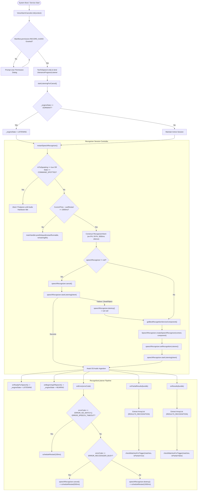
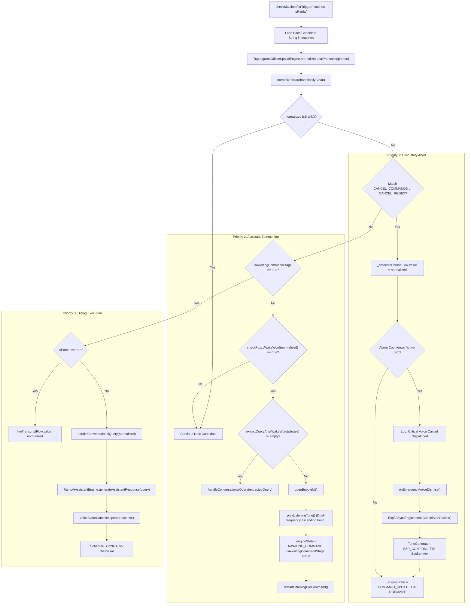
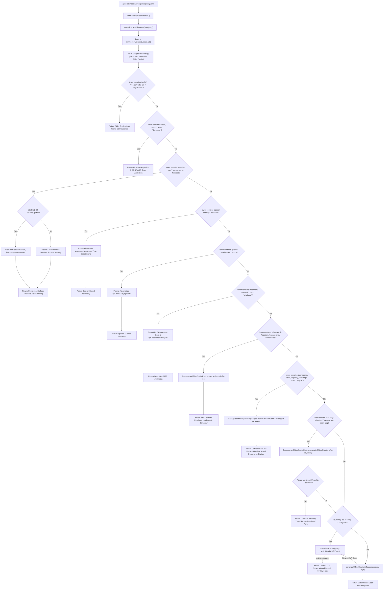
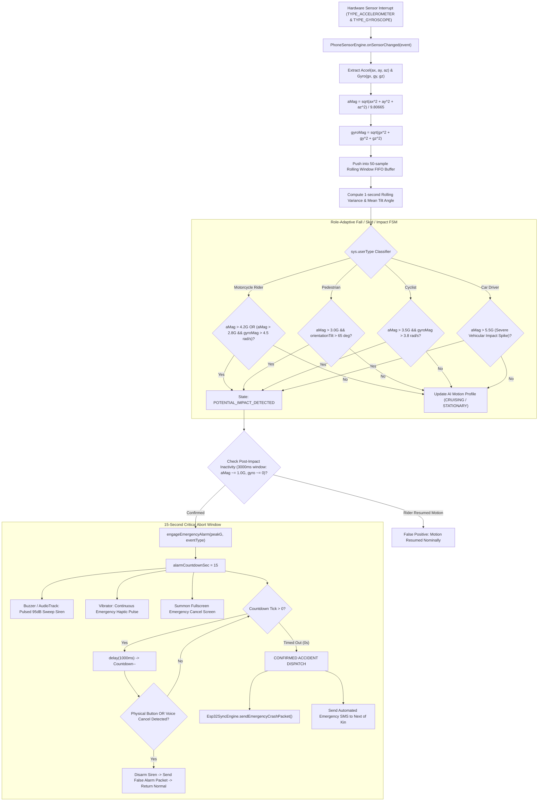

# RAMS Master Code Execution Flowcharts: Function-by-Function Engineering Plan
===============================================================================
Author: RAMS Research & Development Team
Discipline: Computer Engineering / Electronics & Communications Engineering
Document Version: 2.5-RevC
Last Updated: November 2026
Diagram Syntax: Mermaid Specification (flowchart TD)

---

## 1. Overview & Architectural Scope
This document provides the exhaustive, block-by-block, function-by-function program execution flowcharts for the Road Accident Monitoring System (RAMS). Designed according to standard IEEE/ABET Computer Engineering and IT program planning specifications, every diagram details conditional branches, state transitions, IPC handlers, memory allocations, and hardware timers without abstraction shortcuts.

---

## 2. Voice AI State Machine & Wake-Word Event Lifecycle



---

## 3. Speech Recognition Priority Routing & Phonetic Normalization



---

## 4. AI Assistant Intent Decision Tree (`generateAssistantResponse`)



---

## 5. 50Hz Sensor Fusion & Emergency Crash Detection Pipeline



---

## 6. BLE GATT to SX1278 LoRa Uplink Pipeline

```mermaid
flowchart TD
    PHONE_EVENT["Phone Event (Telemetry / Crash Alert / Cancel / Ping)"] --> BUILD_JSON["Serialize JSON Payload with Rider Token"]
    BUILD_JSON --> CHUNK_BLE["Chunk into 20-byte MTU Slices (if required)"]
    CHUNK_BLE --> WRITE_GATT["writeCharacteristic(RX_CHAR, chunk) via BLE GATT"]
    WRITE_GATT --> WEARABLE_RX["Wearable ESP32-S3: RamsRxCallbacks.onWrite()"]

    WEARABLE_RX --> ASSEMBLE_BUF["Buffer Chunks & Detect Trailing Newline or Full JSON"]
    ASSEMBLE_BUF --> DESERIALIZE["DynamicJsonDocument doc(3072): deserializeJson()"]
    DESERIALIZE --> PARSE_TYPE{"doc['type']"}

    PARSE_TYPE -- "PING" --> HANDLE_PING["Extract seq, lat, lon, phoneEpoch"]
    HANDLE_PING --> PACK_PING_PKT["Construct PingPacket (PKT_PING, 13-byte header, uint64 phoneEpoch)"]
    PACK_PING_PKT --> LORA_TX_PING["loraSendPing() -> LoRa.write(buf, sizeof(PingPacket))"]

    PARSE_TYPE -- "EMERGENCY" / "ALERT" --> HANDLE_ALERT["Extract lat, lon, eventType, peakG"]
    HANDLE_ALERT --> PACK_ALERT_PKT["Construct AlertPacket (PKT_ALERT, aMag, GPS coordinates)"]
    PACK_ALERT_PKT --> LORA_TX_ALERT["loraSendAlert() -> LoRa.write(buf, sizeof(AlertPacket))"]

    PARSE_TYPE -- "CANCEL_ALERT" --> HANDLE_CANCEL["detectionAcknowledgeAlert() & buzzerOff()"]
    HANDLE_CANCEL --> PACK_FALSE_PKT["Construct FalseAlarmPacket (PKT_FALSE_ALARM)"]
    PACK_FALSE_PKT --> LORA_TX_CANCEL["loraSendFalseAlarm() -> LoRa.write(buf, sizeof(FalseAlarmPacket))"]

    PARSE_TYPE -- "TELEMETRY" --> HANDLE_TEL["gpsSetExternalLocation(lat, lon, spd, alt)"]
    HANDLE_TEL --> INTERVAL_TEL{"Interval >= 30,000ms?"}
    INTERVAL_TEL -- Yes --> PACK_TEL_PKT["Construct TelemetryPacket (PKT_TELEMETRY, batteryPct)"]
    PACK_TEL_PKT --> LORA_TX_TEL["loraSendTelemetry() -> LoRa.write(buf, sizeof(TelemetryPacket))"]
    INTERVAL_TEL -- No --> SERIAL_LOG["Serial Pretty Print Telemetry"]

    LORA_TX_PING --> RF_TRANSMIT["SX1278 Ra-02: 433 MHz Air Transmission (SF9, BW125kHz, CR4/5)"]
    LORA_TX_ALERT --> RF_TRANSMIT
    LORA_TX_CANCEL --> RF_TRANSMIT
    LORA_TX_TEL --> RF_TRANSMIT
```

---

## 7. LoRa Receiver Base Station & Desktop Ingestion Pipeline

```mermaid
flowchart TD
    AIR_PACKET["433MHz LoRa Packet Arrives at Base Station Antenna"] --> RX_IRQ["SX1278 DIO0 Interrupt -> LoRa.parsePacket()"]
    RX_IRQ --> READ_BYTES["Read Raw Byte Stream into uint8_t buf[256]"]
    READ_BYTES --> CHECK_LEN{"bytesRead >= sizeof(PacketHeader) (13 bytes)?"}
    CHECK_LEN -- No --> DISCARD["Drop Malformed / Noise Burst Packet"]
    CHECK_LEN -- Yes --> FLASH_LED["neopixelTriggerPacketFlash() (Blue Beacon)"]

    FLASH_LED --> READ_HEADER["Extract packetType = buf[0], token = buf[1..8]"]
    READ_HEADER --> READ_SIGNAL["rssi = LoRa.packetRssi(), snr = LoRa.packetSnr()"]
    READ_SIGNAL --> ROUTE_TYPE{"packetType"}

    ROUTE_TYPE -- PKT_ALERT --> PARSE_ALERT["Cast to AlertPacket*"]
    PARSE_ALERT --> EMIT_ALERT_SERIAL["Serial.printf('{\"event\":\"LORA_ALERT\",\"token\":\"%s\",\"type\":\"%s\",\"lat\":%.6f,\"lon\":%.6f,\"aMag\":%.2f,\"rssi\":%d,\"snr\":%.1f}')"]

    ROUTE_TYPE -- PKT_FALSE_ALARM --> PARSE_FALSE["Cast to FalseAlarmPacket*"]
    PARSE_FALSE --> EMIT_FALSE_SERIAL["Serial.printf('{\"event\":\"LORA_FALSE_ALARM\",\"token\":\"%s\",\"lat\":%.6f,\"lon\":%.6f,\"rssi\":%d,\"snr\":%.1f}')"]

    ROUTE_TYPE -- PKT_PING --> PARSE_PING["Cast to PingPacket*"]
    PARSE_PING --> EMIT_PING_SERIAL["Serial.printf('{\"event\":\"LORA_PING\",\"token\":\"%s\",\"seq\":%lu,\"lat\":%.6f,\"lon\":%.6f,\"phoneEpoch\":%llu,\"rssi\":%d,\"snr\":%.1f}')"]

    ROUTE_TYPE -- PKT_TELEMETRY --> PARSE_TEL["Cast to TelemetryPacket*"]
    PARSE_TEL --> EMIT_TEL_SERIAL["Serial.printf('{\"event\":\"LORA_TELEMETRY\",\"token\":\"%s\",\"lat\":%.6f,\"lon\":%.6f,\"batt\":%d,\"rssi\":%d,\"snr\":%.1f}')"]

    EMIT_ALERT_SERIAL --> USB_CDC["USB Serial Bridge (115200 baud)"]
    EMIT_FALSE_SERIAL --> USB_CDC
    EMIT_PING_SERIAL --> USB_CDC
    EMIT_TEL_SERIAL --> USB_CDC

    USB_CDC --> DESKTOP_IN["Desktop App (Program.cs): ProcessIncomingReceiverPacket()"]
    DESKTOP_IN --> DESKTOP_ROUTE["ProcessIncomingPayload()"]

    subgraph Desktop_Operations_Engine ["Desktop Command & Dispatch Engine"]
        DESKTOP_ROUTE --> CHECK_PAYLOAD_EVENT{"event field"}
        CHECK_PAYLOAD_EVENT -- "LORA_ALERT" --> STORE_INCIDENT["Save to incidents.json & Play Audio Alert Strobe"]
        CHECK_PAYLOAD_EVENT -- "LORA_FALSE_ALARM" --> CLEAR_INCIDENT["Mark Incident RESOLVED / DISMISSED in Store"]
        CHECK_PAYLOAD_EVENT -- "LORA_PING" --> COMPUTE_PING["Calculate Delay: currentEpoch - phoneEpoch, Haversine Distance to Base Station"]
        COMPUTE_PING --> STORE_PING["Store in _pingLogsJsonList (FIFO max 1000)"]
        STORE_INCIDENT --> BROADCAST_WS["Push Update to Embedded React Dashboard via /api/events"]
        CLEAR_INCIDENT --> BROADCAST_WS
        STORE_PING --> SERVE_PING_API["Serve via GET /api/ping-log"]
    end
```

