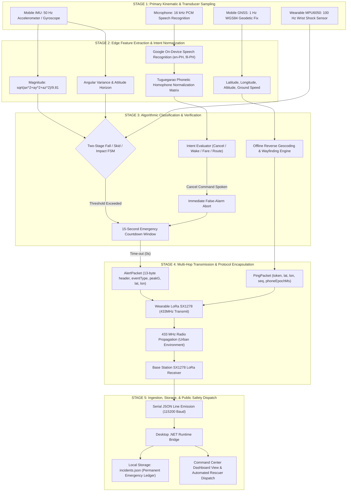
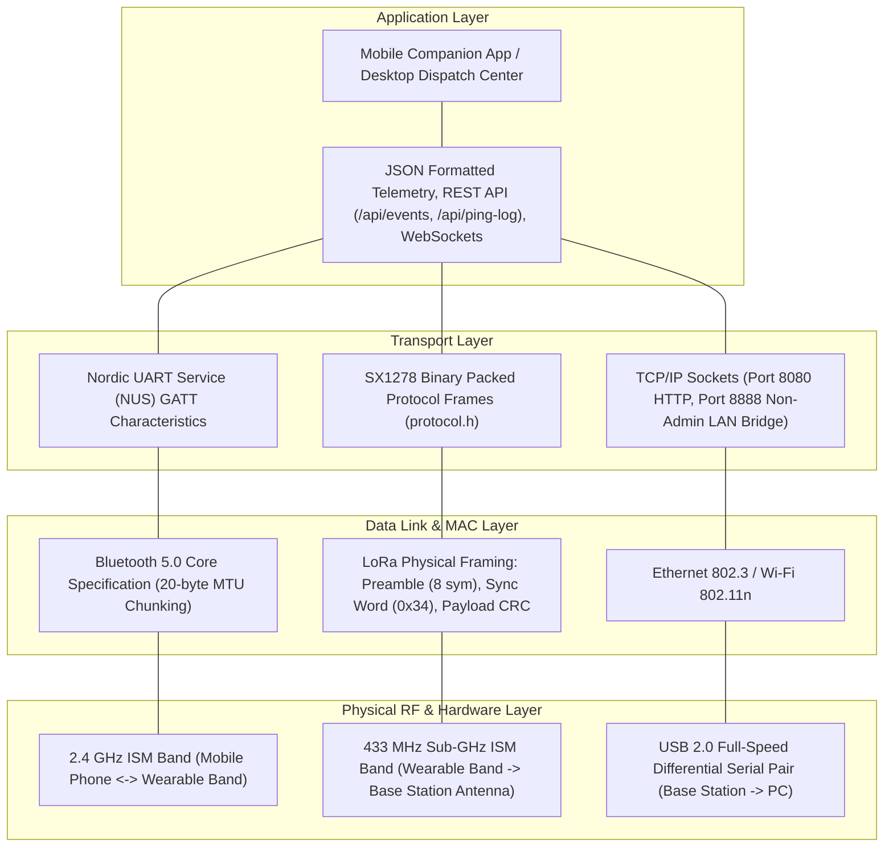

# RAMS Master System Block Diagrams: Full Architectural & Data Collection Topology
===============================================================================
Author: RAMS Research & Development Team
Discipline: Computer Engineering / Electronics & Communications Engineering
Document Version: 2.5-RevC
Last Updated: November 2026
Diagram Syntax: Mermaid Specification (flowchart LR / flowchart TD)

---

## 1. Overview & Architectural Hierarchy
This document specifies the complete system-level block diagrams for the Road Accident Monitoring System (RAMS). In contrast to procedural flowcharts depicting internal software control flow, these block diagrams model physical hardware boundaries, inter-subsystem data buses, wireless RF links, transducer pipelines, and empirical bench-testing data collection topologies.

---

## 2. Master System Hardware & Subsystem Block Diagram

```mermaid
flowchart LR
    subgraph NODE_1 ["NODE 1: Mobile Sensory & Edge AI Subsystem (Android 14)"]
        direction TB
        SENSORS["Internal Sensor Array<br/>- InvenSense Gyroscope (50Hz)<br/>- 3-Axis Accelerometer (50Hz)<br/>- GNSS Multi-Constellation GPS (1Hz)"]
        SPEECH_IN["Audio Transducer<br/>- MEMS Microphone Array<br/>- Noise Suppression Circuit"]
        
        subgraph PHONE_CORE ["Compute Core (Helio G99 / NPU & CPU)"]
            FUSION["PhoneSensorEngine<br/>50Hz Kinematic Filter & Motion Classifier"]
            AI_CORE["RamsAiAssistantEngine<br/>Offline Heuristic + Gemini 3.8 Distillation"]
            SPATIAL["TuguegaraoOfflineSpatialEngine<br/>16 Landmarks & Haversine Reverse Geocoder"]
            VOICE_FSM["VoiceAlarmCanceler<br/>Phonetic Normalizer & Safety Abort FSM"]
        end

        UI_LAYER["User Interaction Plane<br/>- Jetpack Compose Touchscreen UI<br/>- Leaflet OpenStreetMap Offline Canvas<br/>- Text-To-Speech (STREAM_MUSIC) Engine"]
        BLE_CLIENT["BLE 5.0 GATT Client<br/>Nordic UART Service (UUID: 6E400001)"]

        SENSORS --> FUSION
        SPEECH_IN --> VOICE_FSM
        FUSION --> AI_CORE
        SPATIAL --> AI_CORE
        VOICE_FSM --> AI_CORE
        AI_CORE --> UI_LAYER
        FUSION --> BLE_CLIENT
        VOICE_FSM --> BLE_CLIENT
    end

    subgraph NODE_2 ["NODE 2: Wearable Safety Node (ESP32-S3 WROOM-1)"]
        direction TB
        BLE_SERVER["BLE GATT Peripheral Server<br/>(TX Char: 6E400003, RX Char: 6E400002)"]
        WEAR_IMU["Onboard IMU (MPU6050)<br/>Wrist Impact & Rotational Variance"]
        WEAR_BTN["Mechanical Push Button<br/>Immediate Physical False-Alarm Abort"]
        
        subgraph WEAR_CORE ["Firmware Architecture (FreeRTOS)"]
            BT_SRV["bt_service.cpp<br/>JSON Packet Parser & Token Sync"]
            DETECT_FSM["detection.cpp<br/>Two-Stage Fall / Skid / Impact FSM"]
            LORA_TX_MOD["lora_tx.cpp<br/>Packet Serialization & SPI Driver"]
        end

        HAPTICS["Haptic / Visual Output<br/>- Piezo Buzzer (95dB PWM Alert)<br/>- WS2812B NeoPixel RGB State Beacon<br/>- Haptic Vibration Motor"]
        SX1278_TX["Semtech SX1278 LoRa Transceiver<br/>433 MHz ISM Band / Ra-02 Module (+17 dBm)"]

        BLE_CLIENT <-. "BLE 2.4 GHz GATT Link<br/>(10Hz Telemetry & Ping)" .-> BLE_SERVER
        BLE_SERVER --> BT_SRV
        WEAR_IMU --> DETECT_FSM
        WEAR_BTN --> DETECT_FSM
        BT_SRV --> LORA_TX_MOD
        DETECT_FSM --> LORA_TX_MOD
        DETECT_FSM --> HAPTICS
        LORA_TX_MOD --> SX1278_TX
    end

    subgraph NODE_3 ["NODE 3: Emergency Base Station Receiver (ESP32-S3)"]
        direction TB
        SX1278_RX["Semtech SX1278 LoRa Receiver<br/>433 MHz (SF9, BW 125kHz, CR 4/5)"]
        
        subgraph RX_CORE ["Receiver Firmware (FreeRTOS)"]
            LORA_RX_MOD["lora_rx.cpp<br/>Continuous Packet Sniffer & CRC Check"]
            PAYLOAD_DECODE["Binary Struct Decoder<br/>(Telemetry, Alert, False Alarm, Ping)"]
        end

        STATUS_IND["Station Telemetry<br/>- RGB Reception Beacon (GPIO48)<br/>- RSSI / SNR Metric Extractor"]
        USB_UART["CP2102 / CH340 USB CDC<br/>Hardware Serial Bridge (115200 Baud)"]

        SX1278_TX -. "Long-Range RF Airwave (433MHz LoRa)<br/>(Tested 1.5km Urban Range)" .-> SX1278_RX
        SX1278_RX --> LORA_RX_MOD
        LORA_RX_MOD --> STATUS_IND
        LORA_RX_MOD --> PAYLOAD_DECODE
        PAYLOAD_DECODE --> USB_UART
    end

    subgraph NODE_4 ["NODE 4: Emergency Command & Dispatch Operations Center"]
        direction TB
        SERIAL_READER["Auto-Detecting Serial Bridge<br/>High-Speed Circular Line Ingestion Buffer"]
        
        subgraph DESKTOP_CORE ["Desktop Rescuer Host (.NET 8 Native Runtime)"]
            PAYLOAD_ROUTER["Program.cs: ProcessIncomingPayload()<br/>Incident Extraction & Coordinate Normalization"]
            PING_MONITOR["LoRa Benchmark Engine<br/>Delay (ms) & Haversine Distance Computer"]
            LOCAL_DB["Persistent File Datastore<br/>- incidents.json (Crash Audit Trail)<br/>- registrations.json (Rider Profiles)"]
            HTTP_SERVER["Embedded Multi-Threaded HTTP Server<br/>(System.Net.HttpListener, Port 8080)"]
        end

        REACT_DASH["Live Dispatch Operator UI<br/>- Leaflet OpenStreetMap Incident Tracker<br/>- Emergency Strobe & Sound Siren<br/>- 1-Click WhatsApp / Telco SMS Dispatch<br/>- Delay & Distance Benchmark Telemetry Table"]

        USB_UART ==> "Direct USB Cable Connection" ==> SERIAL_READER
        SERIAL_READER --> PAYLOAD_ROUTER
        PAYLOAD_ROUTER --> LOCAL_DB
        PAYLOAD_ROUTER --> PING_MONITOR
        PAYLOAD_ROUTER --> HTTP_SERVER
        PING_MONITOR --> HTTP_SERVER
        HTTP_SERVER <== "REST / SSE / WebSockets" ==> REACT_DASH
    end
```

---

## 3. End-to-End Data Collection & Ingestion Process Block Diagram



---

## 4. Heterogeneous Multi-Tier Wireless Communication Stack



---

## 5. LoRa Benchmark Ping Delay & Distance Propagation Data Collection Architecture

```mermaid
flowchart LR
    subgraph BENCHMARK_MOBILE ["Mobile App: SettingsScreen.kt & RamsViewModel.kt"]
        PING_TOGGLE["Ping Distance Mode Toggle: ACTIVE"]
        TICK_3S["Periodic 3000ms Timer Job"]
        GPS_SAMPLER["WGS84 GPS Sampler (lat, lon)"]
        CLOCK_SAMPLER["UTC Epoch Clock Sampler (phoneEpochMs)"]
        SEQ_COUNTER["Monotonic Sequence Counter (seq++)"]

        PING_TOGGLE --> TICK_3S
        TICK_3S --> GPS_SAMPLER
        TICK_3S --> CLOCK_SAMPLER
        TICK_3S --> SEQ_COUNTER
        GPS_SAMPLER --> BLE_PACK["Esp32SyncEngine.sendPingBenchmarkPacket()"]
        CLOCK_SAMPLER --> BLE_PACK
        SEQ_COUNTER --> BLE_PACK
    end

    subgraph BENCHMARK_WEARABLE ["Safety Wearable: bt_service.cpp & lora_tx.cpp"]
        BLE_PACK ==> "BLE GATT Characteristic Write" ==> WEAR_INGEST["Parse JSON: type=='PING'"]
        WEAR_INGEST --> LORA_PACK["Construct PingPacket (PKT_PING, 13-byte header)"]
        LORA_PACK --> RF_SEND["SX1278 LoRa TX (433MHz, SF9, BW125)"]
    end

    subgraph BENCHMARK_RECEIVER ["Base Station: lora_rx.cpp"]
        RF_SEND -. "Over-the-Air RF Propagation" .-> RF_RECV["SX1278 LoRa RX"]
        RF_RECV --> MEASURE_RF["Measure RSSI (dBm) & SNR (dB)"]
        MEASURE_RF --> EMIT_PING_JSON["Emit Serial JSON: LORA_PING with rxMillis & phoneEpoch"]
    end

    subgraph BENCHMARK_DESKTOP ["Desktop App: Program.cs"]
        EMIT_PING_JSON ==> "USB Serial 115200" ==> DESK_PARSE["ProcessIncomingPayload(payload)"]
        DESK_PARSE --> CALC_DELAY["Calculate Propagation Delay:<br/>delayMs = CurrentUtcMs - phoneEpochMs"]
        DESK_PARSE --> CALC_DIST["Calculate Haversine Distance:<br/>distanceMeters = Haversine(pingLat, pingLon, baseLat, baseLon)"]
        CALC_DELAY --> LOG_ROW["Append Record to _pingLogsJsonList:<br/>[seq, token, lat, lon, delayMs, distanceMeters, rssi, snr]"]
        CALC_DIST --> LOG_ROW
        LOG_ROW --> BENCH_TABLE["Display in Command Center Telemetry Benchmark Table"]
    end
```

